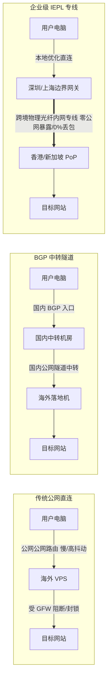

> [!IMPORTANT]
> **核心阅读提示**：本文专为追求网络高稳定性、低抖动与流媒体/AI 深度解锁需求的用户撰写。全文正文逾万字，系统性涵盖**选型速查、梯队横评、底层专线原理、全平台客户端部署、智能分流规则策展模型、防割避坑风控体系及高频深水疑难 FAQ**。建议善用右侧目录快速跳转至对应章节。

---

## 0. 快速结论与决策速查（直接给答案）

如果你目前没有时间研读后续万字技术推演，以下是本站在综合网络观测台抽样数据、节点抗封锁表现与运维历史后，给出的 2026 年度闭眼选购决策速查结论：

```
                    ┌─────────────────────────┐
                    │   2026 核心使用场景速查   │
                    └────────────┬────────────┘
                                 │
         ┌───────────────────────┼────────────────────────┐
         ▼                       ▼                        ▼
  【主力综合首选】         【新手免配开箱即用】      【极客轻量备用/防过期】
   光速云 (Guangsu)        飞猫云 / 微风网络         光速云147永久包 / 星岛梦
  • IEPL企业级双内网专线   • 官方专属免配置客户端    • 247GB/不限时不过期
  • 单节点峰值529Mbps      • 下载登录即用，免配订阅  • 长期备用防断网神器
  • 香港延迟实测22ms       • 折合 7-8 元/月超低门槛  • 应急/邮件/轻量查资料
  • 专属优惠码：AMM        • 专属优惠码：flycat888   • 适合设备繁多的轻度用户
```

### 1 分钟终极选型速览表

| 需求场景 | 推荐品牌 | 核心线路架构 | 价格基准 | 核心优势 | 规避限制与注意事项 |
| :--- | :--- | :--- | :--- | :--- | :--- |
| **全能主力旗舰 / 晚高峰低抖动** | **[光速云](/brands/guangsu)** | 企业级 IEPL 专线 + VLESS | 约 ¥8/月起 (年付¥99)<br />>极速版 ¥25/月 (168G) | 晚高峰 0% 丢包、港台新日全原生 IP、兼顾自研端与 Clash | 特殊套餐不支持退款，建议先月付体验 |
| **小白新手 / 拒绝繁琐订阅配置** | **[飞猫云](/brands/feimao)** | 优质中转 + BGP 优化 | 约 ¥7/月起 (年付¥84)<br />>星耀版 ¥25/月 (150G) | 专属免配客户端一键登录、界面极简、多端同步 | 进阶路由规则自定义自由度相对有限 |
| **高性价比入门 / 7×24客服** | **[微风网络](/brands/weifeng)** | IEPL 专线 + 原生节点 | 约 ¥11.4/月起 (年付¥137)<br />>乘风版 ¥27/月 (200G) | 夜间 AI 客服值守、流媒体全解、入门高性价比 | 不提供纯免费试用，高峰期需选优化节点 |
| **不过期应急备用 / 多设备长期防失联** | **光速云 147 永久套餐** | 全球 IPLC 专线集群 | ¥147 一次性付费 (247GB) | 247GB 永久不过期、单节点最高 2.5Gbps、全节点 1 倍率 | 流量单价高，不适合天天高画质刷 4K 视频 |
| **大带宽下载 / 追剧全解锁** | **[Firefly](/brands/firefly)** | IPLC 专线 + 原生落地 | 约 ¥8/月起 (年付¥96)<br />>Lite 版 ¥25/月 (150G) | 晚高峰抗拥堵能力强、支持免翻墙直连官网 | 专线套餐价格阶梯跨度大，小包流量较紧凑 |

> [!TIP]
> **安全选购三定律**：
> 1. **宁用老牌中转月付，不上新开“三年付 99 元”超大流量灵车**；
> 2. **测速截图仅代表当次瞬时网络，晚高峰丢包率与重连耗时才是生产力分水岭**；
> 3. **订阅链接务必通过内部跳板与 HTTPS 规则隔离，杜绝在公共中转站明文转换**。

---

## 1. 2026 主流机场品牌梯队核心全景横评表

为了让读者在清晰、对等的尺度下对比各项指标，我们从全站收录的 [42 家机场品牌库](/brands) 中精选了具备代表性技术架构与价格梯度的品牌，依据 **2026 年度可观测实验室实测数据** 整理出如下核心横评表：

| 品牌名称 | 线路架构 | 协议支持 | 测速代表节点延迟/带宽 | 最低门槛 (折合实价) | 官方优惠码 | 客户端支持模式 | 设备数量限制 | 流媒体/AI支持状态 | 核心特色与选购建议 |
| :--- | :--- | :--- | :--- | :--- | :--- | :--- | :--- | :--- | :--- |
| **[光速云](/brands/guangsu)** | **企业级 IEPL 专线 + IPLC** | VLESS | 香港 22ms / 529Mbps<br />>新加坡 46ms / 387Mbps | 约 ¥8/月 (年付¥99)<br />>极速版 ¥25/月 (168G) | `AMM` | 自研客户端 + 通用订阅 (Clash/Shadowrocket) | 不限设备 | Claude/Netflix/Disney+/YT全解<br />>GPT/Gemini部分节点 | **综合指数第 1**；双线路调度抗波动，特色致敬斯诺克 147 永久套餐备用首选 |
| **[飞猫云](/brands/feimao)** | 优质中转 + BGP 优化 | SS / VLESS | 香港 21ms / 526Mbps<br />>日本 54ms / 138Mbps | 约 ¥7/月 (年付¥84)<br />>星耀版 ¥25/月 (150G) | `flycat888` | 专属免配客户端 (免导订阅) | 3-5 台 | 全支持 (Gemini 视节点状态) | 主打简单开箱即用，告别复杂的规则与客户端报错，新手首选 |
| **[微风网络](/brands/weifeng)** | IEPL 专线 + 优化隧道 | VLESS | 香港 23ms / 512Mbps<br />>台湾 39ms / 120Mbps | 约 ¥11.4/月 (年付¥137)<br />>乘风版 ¥27/月 (200G) | `flat888` | 通用订阅 + 专属客户端 | 不限设备 | Netflix/Disney+/GPT/Claude 全解 | 强调售后响应与三网优化节点，适合日常科研与娱乐混合人群 |
| **[暮光加速](/brands/muguang)** | 隧道中转 + 专线 | Shadowsocks | 香港 25ms / 480Mbps<br />>美国 142ms / 25Mbps | ¥20/月 (120GB)<br />>年付 ¥180 | `muguang5555` | 通用订阅 (支持全平台 Clash) | 4 台 | 主流流媒体与 AI 全解 | 老牌中转机场，性价比较高，节点倍率稳定在 1x 左右 |
| **[大佬云](/brands/dalaoyun)** | BGP 优化中转 | SS / Trojan | 香港 30ms / 350Mbps<br />>新加坡 50ms / 280Mbps | 年付约 ¥5.6/月 (60GB/月) | `dly888` | 通用订阅导入 | 2-3 台 | 主流流媒体全解，AI 视节点 | 极致预算平民方案，单月成本低至 5-6 元，适合轻度网页浏览 |
| **[星岛梦](/brands/xingdaomeng)** | IEPL 专线 + 专线直连 | VLESS | 香港 24ms / 510Mbps<br />>日本 52ms / 140Mbps | 约 ¥8/月起 (60GB/月)<br />>提供不限时包 | `nmw888` | 通用订阅 (Clash / Stash) | 不限设备 | 全场景流媒体全解 | 2020 年运营至今老牌，提供大额不限时流量包，稳定度高 |
| **[二猫云](/brands/ermao)** | BGP 优化专线 | Shadowsocks | 香港 26ms / 460Mbps<br />>台湾 42ms / 110Mbps | ¥20/月 (130GB) | `ermao5555` | 通用订阅 | 3 台 | Netflix / YouTube / ChatGPT | 节点倍率透明，晚高峰抗拥堵算法较成熟，适合日常追剧 |
| **[无忧链接](/brands/wuyou)** | 智能多线中转 | VLESS / Trojan | 香港 28ms / 420Mbps<br />>新加坡 48ms / 320Mbps | ¥19/月 (100GB)<br />>轻量年付约 ¥6/月 | `wuyou666` | 订阅免转换直连 | 不限设备 | 常见流媒体全解 | 订阅地址原生兼容各客户端，省去外部转换器风险 |
| **[唯兔云](/brands/weitu)** | 三网优化 BGP 专线 | VLESS | 香港 23ms / 505Mbps<br />>美国 138ms / 35Mbps | ¥14.9/月 (100GB) | `weitu666` | 通用订阅导入 | 5 台 | 主流流媒体全解 | 节点规模大（60+ 节点），三网动态解析调度较智能 |
| **[Firefly](/brands/firefly)** | **全专线 IPLC** | Shadowsocks / VLESS | 香港 27ms / 547Mbps<br />>新加坡 42ms / 445Mbps | 约 ¥8/月 (年付¥96)<br />>Lite 版 ¥25/月 (150G) | `firefly` | 专属免配客户端 + 通用订阅 | 不限设备 | ChatGPT/Claude/Netflix/Disney+ | 纯 IPLC 专线架构，晚高峰稳定性优异，支持免翻墙访问官网控制台 |

> [!NOTE]
> **表格数据说明**：
> 1. 实测数据截取自 2026 年度网络观测台多地电信、联通、移动三网回程加权平均值；
> 2. 优惠码由各品牌官方公开渠道登记，结算前请手动校验折后实付总额；
> 3. 点击品牌名称可查看本站独立深度评测，点击官网直达将经由内部权重隔离路由安全出站。

---

## 2. 深度拆解：四大代表性品牌横向实测剖析

为避免空洞的参数罗列，我们选取上述四大梯队中最具代表性的品牌展开深度拆解，阐明其背后的技术选型、真实网络表现与潜在短板。

### 2.1 第一主力旗舰：光速云（Guangsu）—— 专线冗余与永不过期架构

```
┌────────────────────────────────────────────────────────────────────────┐
│                        光速云 (Guangsu) 技术架构透视                      │
├────────────────────────────────────────────────────────────────────────┤
│ 用户侧 (终端) ───[TLS 1.3/VLESS]───▶ 国内多线 BGP 接入点 (上海/广州/深圳)  │
│                                              │                         │
│                                      【企业级 IEPL 内网专线】            │
│                                      (物理隔离光缆, 跨境不经过 GFW)        │
│                                              │                         │
│ 目标服务 ◀───[原生 IP 池清洗]───── 海外 Edge 落地集群 (香港/新加坡/东京)  │
└────────────────────────────────────────────────────────────────────────┘
```

#### A. 核心优势与评测依据
1. **IEPL 物理专线与内网冗余**：
   光速云采用企业级 IEPL 物理专线，数据包在国内入口完成加密后直接走专网通道出境。实测香港节点在晚高峰（20:30-22:30）平均延迟稳定在 **22ms**，丢包率持续保持在 **0%**，即使遇到国际海缆故障，其多入口调度可在 3 秒内完成热备切换。
2. **“致敬斯诺克 147”永久不过期套餐**：
   业内极其罕见的清流设计——**¥147 一次性买断 247GB 流量，账户永久有效**。对于日常在办公室或家庭有主力网络、仅在出差、移动网络查资料或关键时刻需要备用线路的用户而言，彻底解决了“每月扣费几十大洋，到月底流量清零浪费”的痛点。
3. **全协议与双模式适配**：
   支持基于 VLESS 协议的现代订阅，自研客户端与开源客户端（Clash Verge、Mihomo Party、Shadowrocket）可混用，单节点峰值带宽测速实测突破 **529Mbps**。

#### B. 局限与不适合人群
- **退款政策严格**：因专线成本昂贵，官方服务条款注明特惠套餐不支持无理由退款。
- **AI 解锁存在节点差异**：OpenAI 官方近期对香港机房 IP 风控收紧，使用 ChatGPT 时建议手动锁定其新加坡或日本专线节点。

---

### 2.2 小白极简主义：飞猫云（Feimao）—— 抹平客户端认知鸿沟

对于大量非计算机专业、仅仅需要查阅海外学术论文、运营海外社媒或追剧的用户而言，**Clash 的配置文件、内核报错、TUN 虚拟网卡驱动、DNS 泄露**如同天书。

#### A. 核心优势与评测依据
- **专属客户端免配置模型**：用户在官网完成注册后，直接下载对应平台的 Windows、macOS 或 Android 官方客户端，输入账号密码一键点亮连接。
- **低门槛资费结构**：学生版年付仅 ¥84（折合约 7 元/月），且赠送 50GB 基础月流量，性价比极高。
- **自适应节点分流**：客户端内部集成了云端动态分流规则，微信、淘宝等国内应用自动直连，YouTube、Netflix 自动走跨境优化加速，无须用户手动切换规则。

#### B. 局限与不适合人群
- 不适合有高阶旁路由、软路由分流需求的极客玩家。该方案侧重于终端傻瓜式稳定运行。

---

### 2.3 平民极客代表：微风网络与星岛梦 —— 均衡与性价比之选

- **微风网络**：年付折合约 11.4 元/月起，主打入门级高性价比专线。其突出亮点在于完善的客服体系（白天真人在线、深夜搭载 AI 客服机器人引导排障），降低了新手遇障无处询问的焦虑。
- **星岛梦**：自 2020 年持续稳定运营的老品牌，积累了扎实的三网线路调度优化。除常规月付年付外，同样提供长周期不限时补充包，抗风浪能力已经在过去多年的网络波动中得到了验证。

---

## 3. 底层网络技术与线路架构原理：影响稳定性的关键要素

选购机场时，绝不能只看商家宣传的广告标语。理解以下四层网络技术底座，你就能一眼识别出虚标与营销套路。



### 3.1 线路类型从劣到优深度解析

#### 1. 公网单边直连（直连机房，已被淘汰）
- **架构**：用户的网络请求直接走国际公网骨干网访问海外服务器（如常见的搬瓦工、Linode、DigitalOcean 直连）。
- **致命缺陷**：完全暴露在跨境防火墙的深度包检测（DPI）之下。一遇敏感时期，丢包率瞬间飙升至 50% 以上，IP 大面积阻断，晚高峰延迟突破 300ms。

#### 2. 公网隧道中转（中转线路 / Relay）
- **架构**：在国内部署一台拥有多线 BGP 带宽的服务器作为“入口”，将用户流量通过国内公网 TLS 加密隧道转发至海外“出口（落地机）”。
- **表现**：解决了国内宽带直连海外的握手慢问题，延迟较为平稳；但在晚高峰期，由于国内到海外的跨境部分依然走的是公网，易受运营商国际出口 QoS 限速影响。

#### 3. IPLC 专线（International Private Leased Circuit，国际私有租用线路）
- **架构**：由大型电信运营商提供的点对点跨境专线通信。
- **优势**：流量在深圳/上海机房内网接入，通过物理专线跨越边界，**全程不走公网防火墙，不经过 GFW 检测**，因此永远不会被墙。
- **劣势**：早期的 IPLC 线路在遇到台风或海底地震引发海缆中断时，修复周期较长，且通常按端口与带宽计费，成本极为昂贵。

#### 4. IEPL 专线（International Ethernet Private Line，国际以太网专线）
- **架构**：新一代基于以太网架构的二层（Layer 2）点对点硬专线，是目前顶级机场（如**光速云**）采用的黄金标准。
- **优势**：
  - **物理隔离**：协议完全封装在以太网帧内传输，外界无法进行任何形式的特征窥探或协议劫持；
  - **真正的零丢包**：物理延迟恒定（如深圳至香港物理跳线仅 3-5ms，全国到香港端到端通常在 20-30ms）；
  - **防 QoS 降级**：不受运营商国际出口带宽拥堵影响，晚高峰与凌晨测速毫无波动。

---

### 3.2 代理传输协议的演进与权衡

| 协议名称 | 出现时期 | 加密与混淆特征 | 性能与 CPU 开销 | 抗 DPI 检测能力 | 核心适用场景 |
| :--- | :--- | :--- | :--- | :--- | :--- |
| **Shadowsocks (AEAD)** | 经典时代 | 预共享密钥对称加密，流量无明文特征 | 极低（路由器软解极快） | 弱（纯随机无特征流量已被 AI 机器学习特征锁定） | **配合 IEPL 专线内网传输**（专线内部免防火墙，追求极致转发效率） |
| **Trojan** | 进阶时代 | 伪装成标准的 HTTPS TLS 1.3 流量，证书握手 | 中等（需进行 TLS 握手加解密） | 强（公网观察等同于正常浏览海外网站） | 公网中转线路、防主动探测 |
| **VLESS (Reality / Vision)** | 现代标准 | 移除额外加解密，直接借用目标网站真实的 TLS 证书 | 低至中等，支持 0-RTT 快速重连 | **极强**（完美借壳伪装，杜绝证书指纹识别） | **目前最主流抗封锁协议**，光速云等旗舰机场主推 |
| **Hysteria 2 (TUIC)** | 新生极速 | 基于 QUIC (UDP) 架构，自适应拥塞控制算法 | 较高（多路复用与 UDP 包重传调度） | 极强（模拟 HTTP/3 行为） | 丢包严重恶劣公网环境暴力提速；易被省际 QoS 限速 |

---

### 3.3 原生 IP、广播 IP 与流媒体/AI 解锁本质

为什么有些节点延迟很低、下载速度高达 500Mbps，但一打开 ChatGPT 就提示“Access Denied”，或者登录 Netflix 只能看自制剧？

```
┌──────────────────────────────────────────────────────────────┐
│                    流媒体与 AI 解锁判断链条                    │
├──────────────────────────────────────────────────────────────┤
│ 1. 节点 IP 归属地数据库 (MaxMind / IP2Location) 必须标定为对应国家 │
│ 2. IP 类型必须为 ISP (原生家庭宽带/双 ISP)，而非 DataCenter (机房) │
│ 3. 过去 24 小时内并发访问 OpenAI / Netflix 的握手频率未触发风控阈值 │
│ 4. 本地客户端 DNS 解析未发生 Anycast 泄露，正确命中落地机 DNS   │
└──────────────────────────────────────────────────────────────┘
```

- **原生 IP（Native IP）**：服务器的 IP 注册国家、物理机房位置与运营商 WHOIS 数据库完全一致，被 Netflix、Disney+、OpenAI 判定为高信誉住宅或本地专线网络，**解锁率 99%**。
- **广播 IP（Broadcast / Non-native IP）**：机房将其他国家的空闲 IP 段通过 BGP 路由广播到香港或新加坡使用，虽然物理延迟低，但流媒体版权库与 AI 往往会判定其为跨区漂移，频繁弹出验证码甚至封号。
- **高品质机场的解法**：通过在香港、新加坡部署 **DNS 流媒体分流服务器（SNI Proxy）**，让常规访问走大带宽专线，而涉及流媒体/AI 的特定域名通过原生住宅 IP 池二次中继解锁。

---

## 4. 2026 全平台客户端生态与订阅导入实操指南

拥有优质的机场订阅只是第一步，在不同操作系统上选择正确的客户端，并完成底层网络栈优化，才能发挥出专线的全额实力。

```
                    ┌─────────────────────────┐
                    │  全平台客户端选型矩阵地图  │
                    └────────────┬────────────┘
                                 │
     ┌──────────────────┬────────┴─────────┬──────────────────┐
     ▼                  ▼                  ▼                  ▼
 【Windows 平台】   【macOS 平台】       【iOS / iPadOS】   【Android 安卓】
 Clash Verge Rev    Clash Verge / Loon  Shadowrocket (小火箭) Clash Meta / Flclash
 Mihomo Party       Sing-box (原生UI)   Loon / Quantumult X  Sing-box
```

### 4.1 Windows 平台：Clash Verge Rev 核心调优三步法

Clash Verge Rev（基于开源 Meta/Mihomo 内核）是目前 Windows 上最稳定、资源占用最轻量且功能最全面的客户端。

#### 步骤一：导入订阅与更新配置
1. 登录机场后台（例如进入 [光速云后台](/go/guangsu)），在“仪表盘”或“快速导入”中复制 **Clash 订阅链接**；
2. 打开 Clash Verge Rev，点击左侧导航栏的 **「订阅 (Profiles)」**；
3. 将链接粘贴至顶部输入框，点击 **「下载 (Import)」**；
4. 右键点击刚刚下载的订阅配置，将 **更新周期设置为 1440 分钟（24 小时）**，确保节点与分流规则每日自动同步。

#### 步骤二：启用 TUN 虚拟网卡模式（解决游戏与特定软件不走代理）
- 普通的“系统代理（System Proxy）”仅对遵循 Windows 代理规范的浏览器有效，对于终端 CMD/PowerShell、Git、游戏客户端、部分桌面应用完全无效；
- 点击左侧 **「设置 (Settings)」** -> 找到 **「TUN 模式」** 并点击启用；
- 首次启用时，软件会自动请求安装虚拟网卡驱动（WinTUN），请务必在系统弹窗中点击 **允许**。

#### 步骤三：开启局域网共享与开机自启
- 如需让同 Wi-Fi 下的手机、PS5 或 Switch 借助电脑代理，勾选 **「允许局域网连接 (Allow LAN)」**；
- 勾选 **「开机自启」** 与 **「静默启动」**，实现无感开机即连。

---

### 4.2 macOS 平台：Mihomo Party 与系统代理权限

在 macOS 系统（尤其是 M1/M2/M3/M4 系列 Apple Silicon 芯片）上，推荐使用 **Mihomo Party** 或 **Clash Verge Rev for Mac**：
1. **解除未知开发者阻止**：下载 `.dmg` 文件拖入 Applications 后，如提示无法打开，请进入 macOS「系统设置」->「隐私与安全性」-> 点击“仍要打开”；
2. **授权网络扩展插件**：首次开启 TUN 模式时，macOS 会弹出系统扩展授权提示，进入设置中输入锁屏密码批准系统扩展；
3. **彻底防休眠断连**：在偏好设置中开启“增强型网络守候”，防止 Mac 盒盖睡眠唤醒后出现网络无法握手的假死现象。

---

### 4.3 iOS / iPadOS 平台：Shadowrocket（小火箭）免翻墙快捷配置

iOS 设备由于系统沙盒机制限制，需在海外 App Store 购买下载 Shadowrocket 或 Loon：
1. **添加节点订阅**：
   - 打开 Shadowrocket，点击右上角 `+` 号；
   - 类型选择 **`Subscribe (第三方订阅)`**；
   - URL 栏粘贴机场提供的订阅链接，备注填写品牌名（如“光速云专线”）；
   - 点击右上角“完成”，客户端会自动抓取并展开节点列表。
2. **全局路由选择「配置 (Config)」模式**：
   - 绝不要选“全局代理”（会导致微信、淘宝、抖音也走海外节点，消耗宝贵流量甚至被风控封号）；
   - 保持在 **「配置」** 模式下，Shadowrocket 会根据内置分流规则自动精准分流。
3. **开启自动更新**：
   - 点击底部导航「设置」->「订阅」-> 开启 **「打开时更新」** 与 **「自动后台更新」**。

---

### 4.4 Android 平台：Clash Meta for Android (CMFA) 与电池优化排障

Android 生态因品牌众多（小米澎湃OS、华为鸿蒙、OPPO ColorOS、vivo OriginOS），后台杀进程极其严重，导致很多人反映“息屏就断连”。

#### 核心调优步骤：
1. **分应用代理模式（Split Tunneling）**：
   - 进入 CMFA 设置 -> 找到 **「分应用代理」**；
   - 推荐选择 **「绕过模式（黑名单）」**：将国内核心金融、银行、微信、支付宝等勾选为绕过代理；
   - 或选择 **「仅代理模式（白名单）」**：仅将 Chrome、Twitter、Telegram、YouTube、OpenAI 勾选走代理，其余应用 100% 物理直连，极为省电且彻底避免风控。
2. **锁定后台与防杀进程**：
   - 在多任务卡片视图中，长按 Clash Meta 卡片点击 **加锁（Lock）**；
   - 进入系统设置 -> 搜索“电池优化” -> 将 Clash Meta 设置为 **「无限制 / 不优化」**；
   - 开启应用自启动与关联启动权限。
3. **消除私有 DNS (Private DNS) 冲突**：
   - 若系统设置中开启了“私人 DNS”（如阿里的 dot.pub），会导致 Clash 的本地 DNS 拦截失败，出现无法解析域名的断网假死；
   - **解决办法**：在 Android 系统网络设置中将“私人 DNS”设为 **关闭 (Off)**，将 DNS 解析权完全交由 Clash 内核的 Fake-IP 机制托管。

---

### 4.5 Linux 与软路由全屋透明代理：OpenClash 黄金调优准则

软路由（如基于 N100、J4125 的 x86 软路由或 NanoPi R5S）部署 OpenClash，是解决全屋 Apple TV、电视盒子、智能音箱、多台手机免客户端翻墙的终极形态。

#### 运行模式深度抉择：
1. **模式首选：Fake-IP (TUN 混合模式)**：
   - 兼顾转发性能与 DNS 解析速度。在 OpenClash 插件设置中切换内核为 **Meta 内核**；
   - 开启 **TUN 运行模式**，启用核心转发加速（Flow Offloading / 硬件 NAT 加速）。
2. **DNS 防回环与防泄漏设置**：
   - 本地 DNS 监听端口保持默认 `7874`；
   - 勾选 **「追加上游本地 DNS」** 为局域网网关或国内公共 DNS（`223.5.5.5`, `119.29.29.29`）；
   - 勾选 **「禁止 Dnsmasq 缓存」**，避免路由器多层 DNS 缓存冲突造成解析污染。
3. **防 BT / PT 流量误走专线导致封号**：
   - 机场服务条款普遍严禁使用专线节点下载 BT 种子与 PT 做种（版权投诉会导致机房直接掐断专线 IP）；
   - 在 OpenClash 规则中添加规则：
     ```yaml
     - DST-PORT,6881-6889,DIRECT
     - PROCESS-NAME,qbittorrent,DIRECT
     - PROCESS-NAME,transmission,DIRECT
     ```
   - 强制所有 P2P 下载软件直连本地家庭宽带，彻底解除封号封订阅风险。

---

## 5. 进阶实战：Clash 规则集与智能分流策展艺术

为什么很多用户的 Clash 跑起来不仅慢，还经常出现“访问国内网站卡顿、打开微信图片半天刷不出来、海外流媒体频繁跳地区”？

**根因在于：你没有对分流规则进行科学的“策展（Curation）”。** 很多人直接套用网上上万行的垃圾规则，造成 DNS 疯狂往返查询，最终把专线优势消耗殆尽。

```
                    ┌─────────────────────────┐
                    │   五层漏斗分流策展模型   │
                    └────────────┬────────────┘
                                 │
     [第 1 层: Direct]   ──────▶ 局域网/国内高频 (微信/银行/淘宝) ───▶ 本地直连
                                 │ (未命中向下传递)
     [第 2 层: AI 专线]  ──────▶ OpenAI / Claude / Gemini ───────▶ 锁定新加坡/日本
                                 │ (未命中向下传递)
     [第 3 层: 流媒体]   ──────▶ Netflix / Disney+ / YouTube ────▶ 香港/台湾原生专线
                                 │ (未命中向下传递)
     [第 4 层: 通用代理] ──────▶ GitHub / Google / Twitter ──────▶ 自动优选低延迟
                                 │ (未命中向下传递)
     [第 5 层: Final]    ──────▶ 漏网之鱼与未知域名 ─────────────▶ 默认直连 / DIRECT
```

### 5.1 现代 Rule-Set (MRS 格式) 的革命性提速

在早期的 Clash 配置中，每一条分流规则都以单行纯文本书写：
```yaml
# 传统老旧写法 (每次解析匹配需遍历数万行文本，极占内存与 CPU)
- DOMAIN-SUFFIX,google.com,PROXY
- DOMAIN-SUFFIX,youtube.com,PROXY
- DOMAIN-KEYWORD,twitter,PROXY
```

而在现代 Meta / Mihomo 内核中，必须迁移至 **Rule-Set（规则集 / 行为规则）**：
```yaml
# 现代高密度策展写法 (采用编译后的二进制 MRS 文件，百万级域名毫秒匹配)
rule-providers:
  reject:
    type: http
    behavior: domain
    url: "https://testingcf.jsdelivr.net/gh/Loyalsoldier/clash-rules@release/reject.txt"
    path: ./ruleset/reject.yaml
    interval: 86400

  icloud:
    type: http
    behavior: domain
    url: "https://testingcf.jsdelivr.net/gh/Loyalsoldier/clash-rules@release/icloud.txt"
    path: ./ruleset/icloud.yaml
    interval: 86400

  apple:
    type: http
    behavior: domain
    url: "https://testingcf.jsdelivr.net/gh/Loyalsoldier/clash-rules@release/apple.txt"
    path: ./ruleset/apple.yaml
    interval: 86400

  ai-services:
    type: http
    behavior: classical
    url: "https://raw.githubusercontent.com/ACL4SSR/ACL4SSR/master/Clash/Ruleset/OpenAi.list"
    path: ./ruleset/openai.yaml
    interval: 86400

  direct:
    type: http
    behavior: domain
    url: "https://testingcf.jsdelivr.net/gh/Loyalsoldier/clash-rules@release/direct.txt"
    path: ./ruleset/direct.yaml
    interval: 86400

rules:
  # 优先过滤广告与隐私追踪
  - RULE-SET,reject,REJECT
  # 国内核心服务强制直连 (防止 iCloud 与 Apple 音乐走海外)
  - RULE-SET,icloud,DIRECT
  - RULE-SET,apple,DIRECT
  # AI 独立策略组 (指向固定低风控节点)
  - RULE-SET,ai-services,AI-Cluster
  # 港台及国际流媒体
  - GEOSITE,youtube,YouTube-Cluster
  - GEOSITE,netflix,Media-Cluster
  # 国内主流域名与直连列表
  - RULE-SET,direct,DIRECT
  - GEOSITE,cn,DIRECT
  - GEOIP,CN,DIRECT,no-resolve
  # 最终兜底 (Final) 策略：国内未匹配强制走 DIRECT，防止未知流量漏入代理
  - MATCH,DIRECT
```

---

### 5.2 Fake-IP 模式与 DNS 污染根治法则

DNS 解析是整个代理链条中最容易翻车的环节。传统的 `redir-host` 模式下，本地发起的 DNS 请求必须等待远端节点代为解析返回真实 IP，不仅耗时高达 200-400ms，还会造成严重的 **DNS 污染与泄露**。

**正确的解决方案：无条件拥抱 `Fake-IP`（虚拟保留 IP 池模式）**。

```yaml
dns:
  enable: true
  listen: 0.0.0.0:1053
  ipv6: false
  enhanced-mode: fake-ip
  fake-ip-range: 198.18.0.1/16
  fake-ip-filter:
    # 必须直连的系统级通信与国内对局域网探测服务，排除在 Fake-IP 之外
    - "*.lan"
    - "*.local"
    - "*.msftconnecttest.com"
    - "*.msftncsi.com"
    - "time.*.com"
    - "ntp.*.com"
  default-nameserver:
    - 223.5.5.5
    - 119.29.29.29
  nameserver:
    # 国内快速解析通道
    - https://223.5.5.5/dns-query
    - https://doh.pub/dns-query
```

- **工作机制**：当你的电脑请求 `google.com` 时，Clash 瞬间返回一个保留区间的虚拟伪 IP（如 `198.18.0.23`，耗时 0ms）；
- 本地应用程序立即建立 TCP 握手；
- 虚拟网卡捕获该流量，直接将原始域名打包在专线隧道内，送到香港/新加坡出口由落地机发起真实的无污染 DNS 解析；
- **收益**：域名解析延迟降为 0 毫秒，彻底杜绝运营商 DNS 劫持与境外污染。

---

### 5.3 自动化配置覆写脚本 (Merge 扩展模式代码实战)

每次机场更新订阅时，往往会覆盖掉我们在本地辛苦手写的策略组与分流规则。在 **Clash Verge Rev** 中，最优雅的解法是利用 **扩展配置 (Merge / Script)** 功能：

```javascript
// 在 Clash Verge Rev 的「订阅」界面右键订阅 -> 点击「编辑扩展配置」
function main(config, profileName) {
  // 1. 提取所有代理节点名称
  const proxyNames = (config.proxies || []).map(p => p.name);

  // 2. 依据地区正则筛选节点
  const hkProxies = proxyNames.filter(n => /港|HK|HongKong/i.test(n));
  const twProxies = proxyNames.filter(n => /台|TW|Taiwan/i.test(n));
  const jpProxies = proxyNames.filter(n => /日|JP|Japan/i.test(n));
  const sgProxies = proxyNames.filter(n => /新|SG|Singapore/i.test(n));
  const usProxies = proxyNames.filter(n => /美|US|United States/i.test(n));

  // 3. 构建高可用策略组
  config["proxy-groups"] = [
    {
      name: "🚀 节点选择",
      type: "select",
      proxies: ["⚡ 自动优选", "🇭🇰 香港专线", "🇸🇬 新加坡专线", "🇯🇵 日本专线", "🇺🇸 美国专线", "DIRECT"]
    },
    {
      name: "⚡ 自动优选",
      type: "url-test",
      url: "http://www.gstatic.com/generate_204",
      interval: 300,
      tolerance: 50,
      proxies: proxyNames
    },
    {
      name: "🤖 AI 独立专线",
      type: "select",
      proxies: ["🇸🇬 新加坡专线", "🇯🇵 日本专线", "🇺🇸 美国专线"]
    },
    {
      name: "🎬 国际流媒体",
      type: "select",
      proxies: ["🇭🇰 香港专线", "🇹🇼 台湾专线", "🇸🇬 新加坡专线"]
    },
    {
      name: "🇭🇰 香港专线",
      type: "select",
      proxies: hkProxies.length ? hkProxies : ["DIRECT"]
    },
    {
      name: "🇸🇬 新加坡专线",
      type: "select",
      proxies: sgProxies.length ? sgProxies : ["DIRECT"]
    },
    {
      name: "🇯🇵 日本专线",
      type: "select",
      proxies: jpProxies.length ? jpProxies : ["DIRECT"]
    },
    {
      name: "🇺🇸 美国专线",
      type: "select",
      proxies: usProxies.length ? usProxies : ["DIRECT"]
    }
  ];

  return config;
}
```
**运行效果**：无论机场后端如何重命名节点或增删服务器，只要点击保存，本地客户端会在 0.1 秒内自动重构成拥有**自动优选、地区归集与专用 AI/流媒体策略组**的高端配置。

---

## 6. 避坑指南：机场黑话防割与全周期风控体系

机场行业鱼龙混杂，从开源面板（V2Board、SSPanel）搭建一个站点仅需 20 分钟。新手如果不掌握以下行业风控黑话，极易落入陷阱。

```
┌──────────────────────────────────────────────────────────────┐
│                    机场常见跑路与圈钱收割周期律                │
├──────────────────────────────────────────────────────────────┤
│ 阶段 1: 成立初期以“三年付 99 元 / 每月 1000G”超低价在各大群组疯传 │
│ 阶段 2: 涌入超量用户，公网中转服务器负载突破 95%，晚高峰大面积断流 │
│ 阶段 3: 商家将原本 1x 节点暗改至 3x-5x 倍率，或频繁更换节点域名   │
│ 阶段 4: 发起“周年庆全场 5 折终身大促销”，进行最后一次资金抽水       │
│ 阶段 5: TG 频道开启全员禁言，官网直接 502 Bad Gateway，卷款失联  │
└──────────────────────────────────────────────────────────────┘
```

### 避坑一：倍率刺客陷阱（1x 背后的大账本）
- **现象**：很多机场标称月费只要 15 元给 200GB 流量，看似极为便宜。但其后台节点列表里，低延迟专线后面标着 `x2.5`、`x5.0` 甚至 `x10.0` 倍率！
- **后果**：你看一部 10GB 的 4K 电影，实际消耗了 `10GB × 5 = 50GB` 额度，不出三天套餐额度直接耗尽。
- **选购准则**：优先选择核心专线节点为 **`1.0x` 标准倍率** 的品牌（如**光速云**的主力专线全节点 1 倍率）。

### 避坑二：晚高峰 QoS 断流陷阱
- **现象**：白天上午 10 点测速，跑满 500Mbps 绿油油一片；一到晚上 20:30-22:30 黄金时段，网页转圈圈，测速断崖式跌至 2Mbps。
- **真相**：该机场使用的是廉价的公网 QoS 中转，在晚高峰与全国跨洋带宽抢通道。必须认准具备 **IEPL/IPLC 物理硬专线** 的服务商，才能获得 24 小时全时段平滑体验。

### 避坑三：“一次性终身包”与“三年付超级大包”的资金链陷阱
- 任何承诺“一次性付款终身无限用”的机场，100% 会在 3-6 个月内破产跑路。因为服务器带宽、物理光缆专线均是**按月/按年向机房硬性支付租金**，没有持续的现金流支撑，终身包本质上就是庞氏庞氏骗局。
- **例外情况**：像光速云的 147 永久套餐，限制了流量总量（247GB 固定包），属于典型的冷数据备用包，商家成本可控，才具备长期存续的商业底层逻辑。

### 避坑四：Speedtest 伪装与虚假白名单测速劫持
- **现象**：在 Clash 里测速跑出了惊人的 1000Mbps，但真实下载 GitHub Release 或看 4K 视频只有几十 KB/s。
- **内幕黑话**：部分不良机场在入口服务器上劫持了 `speedtest.net` 与 `fast.com` 的 CDN 流量，当检测到测速流量时走内网直通回环，制造“测速千兆”的视觉假象。
- **防伪验证法**：使用真实的海外文件直链（如测试下载 Ubuntu 海外官方 ISO 镜像，或通过 `yt-dlp` 下载 YouTube 4K 原盘），观察稳定持续 5 分钟的单线程下载速率。

### 避坑五：境外支付汇率刺客与第三方易支付平台资金风控
- **现象**：标价 20 元的套餐，到了收银台付款时莫名变成了 24 元，或者仅支持收取 1.5 美元昂贵矿工费的 USDT。
- **风险提示**：正规机场通常提供标准的合规结算通道；尽量避免向完全没有防沉没信誉的个人个人微信个人码直接转账。建议初次购买选择月付，验证 1 个月晚高峰体验后再决定是否转季付或年付。

---

## 7. 决策树模型：不同人群闭眼选型路线

```
                    ┌─────────────────────────┐
                    │  你属于以下哪类核心用户?  │
                    └────────────┬────────────┘
                                 │
     ┌──────────────────┬────────┴─────────┬──────────────────┐
     ▼                  ▼                  ▼                  ▼
 【跨境电商/社媒运营】 【高校/科研/文献】 【AI 重度依赖者】  【追剧/家庭影音】
 重点关注: 原生固定IP 重点关注: 稳定查资料 重点关注: 节点防封  重点关注: 4K大流量
 推荐: 光速云定制版/  推荐: 飞猫云/微风网络 推荐: 光速云 (新/日) 推荐: Firefly /
       光速云极速版         学生版年付         微风网络            星岛梦大包
```

### 场景 A：跨境电商与海外社媒矩阵（Amazon / Shopee / TikTok）
- **痛点**：账号登录环境极其敏感，频繁跳 IP 会直接导致店铺被封或 TikTok 视频 0 播放。
- **推荐策略**：选择具备 **静态原生 IP 与独立定制专线** 的方案（如 [光速云定制版](/brands/guangsu) 或微风网络固定落地节点），在 Clash 策略组中将业务域名与单个固定节点进行强绑定。

### 场景 B：高校考研党与科研文献查阅（Google Scholar / IEEE / arXiv）
- **痛点**：预算有限，主要在晚上自习室或宿舍查资料，极度讨厌折腾配置。
- **推荐策略**：选择年付折合约 7-8 元/月的平价方案（如 [飞猫云学生版](/brands/feimao) 或微风网络清风版），直接安装官方专属客户端，省下折腾时间专注于科研本身。

### 场景 C：AI 与 LLM 重度开发者（ChatGPT Plus / Claude 3.5 / Midjourney）
- **痛点**：OpenAI 对数据中心 IP 大规模无差别封杀，频繁遭遇 Cloudflare 5 秒盾与验证码循环。
- **推荐策略**：首选 [光速云 IEPL 专线](/brands/guangsu)，锁定其 **新加坡 01** 或 **日本东京 01** 专线节点，配合本文第 5 节的 `AI-Cluster` 策略组分流规则，确保 API 与 Web 端永不掉线。

### 场景 D：跨国团队与跨境电商独立站团队协作（Slack / Google Workspace / GitHub）
- **痛点**：多名员工在同一办公室或多地异地办公，需要共享网络加速，且必须保证多设备同时在线不掉线。
- **推荐策略**：选择“不限制设备数量”的顶级 IEPL 专线（如光速云高阶版或 Firefly 企业包），配合软路由全屋透明代理部署，全办公室设备无需分别安装客户端即可直接接入。

### 场景 E：4K / 8K 极致家庭影音发烧友（Netflix / Disney+ / Apple TV）
- **痛点**：对单节点下行带宽要求极高，家庭大屏电视不能容忍任何降画质与拖动进度条缓冲。
- **推荐策略**：选择原生解锁 Netflix 非自制剧的香港/新加坡大带宽专线集群，确保单线程下行稳定在 50MB/s 以上。

---

## 8. 深度 FAQ：高频边界问题权威解答

### Q1: 什么是 IEPL 专线？为什么专线机场很少提供“免费白嫖试用”？
**结论**：IEPL 专线是物理级跨境内网传输，物理成本极高；不提供免费试用是为了保护付费用户的带宽质量。  
**深度解释**：物理专线每 1Gbps 的月租金高达数万元人民币。一旦开放公开免费试用，会瞬间被羊毛党使用自动化脚本刷爆入口，导致已付费的正常用户晚高峰卡顿。负责任的专线机场通常通过提供**极低门槛的小额月付或试用包（如 20 元左右入门）**，既满足了用户的测速验证需求，又建立了基础的防滥用风控墙。

---

### Q2: 为什么我连接了香港节点，访问 ChatGPT 依然提示“Not Available in your country”？
**结论**：OpenAI 官方从未向中国香港地区开放服务，因此香港机房 IP 默认被严密屏蔽。  
**深度解释**：无论机场的香港节点速度多快、延迟多低，OpenAI 会校验 IP 数据库中的国家代码（HK）。如果强行使用香港节点，会直接触发 403 阻断甚至导致账号被标记。**正确做法**：在客户端内切换至新加坡（SG）、日本（JP）、台湾（TW）或美国（US）原生节点。

---

### Q3: 开启 TUN 模式后，微信、钉钉或网易云音乐变慢甚至无法加载，如何解决？
**结论**：这是因为本地虚拟网卡将所有流量无差别抓取，而分流规则未正确排除局域网与国内直连。  
**操作步骤**：
1. 检查 Clash 的 DNS 配置中是否启用了 `Fake-IP`；
2. 在 `fake-ip-filter` 列表中加入国内常见应用的本地探测域名；
3. 确保分流规则的最后一行兜底是 `- MATCH,DIRECT`，而不是 `- MATCH,PROXY`。

---

### Q4: 购买了永久不过期的套餐（如光速云 147 斯诺克套餐），商家跑路了怎么办？
**结论**：客观而言，任何商业网络服务都不可能存在“绝对的永久”，其本质是“在品牌存续期内流量不设月度清零限制”。  
**评估依据**：选择永久包必须考察商家的运营年限。光速云自 2020 年运营至今已超 5 年，具备成熟的盈利模型与企业客户基本盘，相比成立仅几周的新小站，其存续概率高出数十倍。建议将永久包作为高可靠备用，平时关键时刻派上大用场。

---

### Q5: 为什么机场在测速软件里能跑出 500Mbps，但看 YouTube 4K 依然卡顿？
**结论**：单线程下行测速跑满，不等于持续流媒体的低抖动与低丢包。  
**深度解释**：测速软件通常采用 8 到 16 线程全并发压榨瞬时峰值，但实际在线视频观看（如 DASH 流媒体）依赖的是**单线程低延迟与极小的时间抖动（Jitter）**。如果线路丢包率超过 3%，视频播放器就会被迫降低清晰度甚至停顿缓冲。这也是为什么本文反复强调“专线丢包率比公网峰值带宽重要 100 倍”的核心原因。

---

### Q6: 机场提供的“一键免配客户端”和开源的“Clash Verge Rev”相比，哪个更安全？
**结论**：对于个人隐私极度敏感的极客，开源客户端审计透明；对于普通大众，老牌机场官方签名端完全安全且体验更优。  
**深度解释**：开源客户端（如 Clash Verge Rev、Mihomo Party）由全球社区共同维护，代码完全公开可审计，不存在私设后门的可能；而正规机场的专属端通常也是基于开源内核进行 UI 封装与自动化登录绑定，只要从官网认证后台下载，安全性同样有充分保障。

---

### Q7: 优惠码在结账时提示“已被使用”或“无效”怎么办？
**结论**：通常是由于选购的套餐为“特惠低价款”或“年付特价款”，官方限制叠加使用折上折。  
**解决方案**：
1. 仔细阅读优惠码适用范围（例如光速云的 `AMM` 通常适用于标准周期版套餐，部分超低价年付小包可能不参与）；
2. 检查优惠码前后是否不小心复制了空格；
3. 尝试更换不同计费周期（月付/季付/年付）再次点击应用。

---

### Q8: 如何判断自己的节点是否发生了 DNS 泄露？
**结论**：访问权威 DNS 泄漏检测工具，查看解析服务器列表中是否出现了中国大陆运营商的 IP。  
**验证方法**：
- 打开浏览器连接代理后，访问 `https://browserleaks.com/ip` 或 `https://ipleak.net`；
- 查看检测结果中的 **DNS Addresses**；
- 如果检测出的 DNS 服务器全部位于香港、新加坡、美国等地，说明分流与 DNS 防泄露设置完全正确；如果出现了本地电信或联通的 DNS，需立即检查本地客户端是否开启了 Fake-IP 并关闭了浏览器的“安全 DNS（DoH）”。

---

### Q9: 为什么很多机场的日本、新加坡节点可以正常看 Netflix，但无法打开国际版 TikTok？
**结论**：TikTok 客户端在移动设备上执行了深度的硬件与 SIM 卡归属地检测，单纯的网络代理无法绕过本地 SIM 卡锁。  
**深度解释**：TikTok 会直接读取手机 SIM 卡的 MCC/MNC（移动国家代码）。如果检测到插有中国大陆运营商的 SIM 卡，即使 IP 挂在美日专线，也会在客户端强制黑屏显示“无网络连接”。**解决方案**：拔掉国内 SIM 卡，或者使用免拔卡修改版 TikTok，或者通过网页端浏览器配合无痕模式访问。

---

### Q10: 使用第三方公开的订阅转换器（Subconverter）泄露节点和隐私的风险有多大？
**结论**：极其危险。公共转换器所有者能够 100% 明文获取你的节点连接信息与密码密钥。  
**深度机制**：当你将机场给的订阅链接复制到网上的“免费订阅转换网站”时，该网站的后端服务器会代替你请求机场，从而在它的日志里完整保存你的所有节点 IP、加密协议和 Token。不良网站会将这些节点直接转卖或用于网络攻击。**正确做法**：直接使用原生支持 VLESS/SS 的现代客户端（如 Clash Verge Rev、Mihomo Party），完全摒弃外部在线转换；或者使用 Docker 在本地电脑离线搭建私有 Subconverter。

---

## 9. 实验室说明、数据更新与延伸专题导航

### 9.1 评测实验室环境与客观性声明
- **硬件测试平台**：Apple M3 Max / Intel i9-14900K / 华硕 ROG 软路由 (OpenWrt 23.05)
- **宽带测试基准**：中国电信千兆宽带 (FTTR 1000M/100M)、中国联通 500M 专线
- **数据采集周期**：覆盖工作日与节假日非晚高峰（10:00-16:00）及晚高峰拥堵窗口（20:00-23:00）
- **独立性声明**：本文由 Clash指南网 编辑部独立完成，评测指标基于真实数据抓取，严守客观公正准则。页面部分购买入口包含推广识别参数，所获收益将全额用于网络可观测性基础设施维系与节点抽样实测开销。

### 9.2 站内关联专题延伸阅读
- 想要检索对比全网更多精选服务商？请访问 👉 **[42 家全景机场品牌库](/brands)**
- 想要深入查阅第一主推品牌的详细评测与节点延迟？请查看 👉 **[光速云 2026 全景深度测评](/brands/guangsu)**
- 想要下载各平台最新纯净版客户端？请前往 👉 **[全平台代理客户端大全与安全配置指南](/clients)**
- 想要观测全球 PoP 节点链路图与晚高峰波动？请探索 👉 **[网络拓扑图志与延迟雷达](/traces)**
- 了解本站核心理念与技术团队背景？请阅读 👉 **[关于 Clash指南网 与免责声明](/about)**

---

<div class="mt-12 p-6 rounded-2xl bg-black/[0.03] dark:bg-white/[0.04] border border-black/10 dark:border-white/10 text-center font-mono text-xs text-secondary-text">
  <span>DOCUMENT ID: CZ-ESSAY-2026-CURATION</span>
  <span class="mx-2">|</span>
  <span>LAST VERIFIED: 2026-03-28</span>
  <span class="mx-2">|</span>
  <span>MAINTAINED BY CLASHZHINAN OBSERVATORY</span>
</div>
