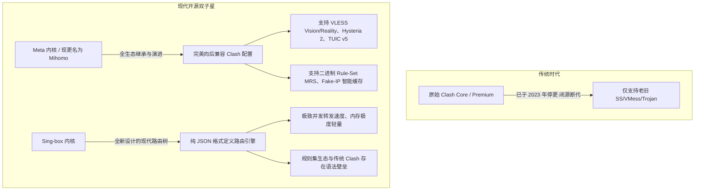

> [!IMPORTANT]
> **核心阅读提示**：在 Clash for Windows (CFW) 与 ClashX 官方相继停更与归档后，基于开源 **Meta / Mihomo** 内核与 **Sing-box** 引擎的现代客户端已全面接管 2026 年的网络生态。本文针对 Windows、macOS、iOS、Android 及 OpenWrt 软路由五大平台，提供**全景选型对比、TUN 虚拟网卡底层原理、保姆级配置实操、自动化 Merge 扩展脚本及全流程排障诊断手册**。全文正文逾万字，建议收藏并善用目录快速定位。

---

## 0. 快速结论与决策速查（直接给答案）

面对市场上眼花缭乱的客户端，普通用户最想知道的是：“**我这台设备目前最应该安装哪个软件？**”

无需纠结，以下是 2026 年基于稳定性、内存占用与维护活跃度的**闭眼选型结论表**：

```
                    ┌─────────────────────────┐
                    │  2026 终端客户端选型速查  │
                    └────────────┬────────────┘
                                 │
     ┌──────────────────┬────────┴─────────┬──────────────────┐
     ▼                  ▼                  ▼                  ▼
 【Windows 平台】   【macOS 苹果】       【iOS / iPadOS】   【Android 安卓】
 首选: Clash Verge  首选: Mihomo Party   首选: Shadowrocket 首选: Clash Meta
       Rev (开源全能)      (精致优雅现代)       (小火箭/全能)      (功能最完善)
 备选: Mihomo Party 备选: Clash Verge    备选: Loon / Stash 备选: Flclash /
                                                               Sing-box
```

### 1 分钟终极选型速览表

| 操作系统 | 首选推荐工具 | 备选工具 | 核心选型依据 | 核心优缺点对比 |
| :--- | :--- | :--- | :--- | :--- |
| **Windows 10 / 11** | **[Clash Verge Rev](/clients)** | Mihomo Party | 开源社区主流标准，基于 Tauri 架构，内存占用低（约 60MB） | **优点**：支持 TUN 模式免配系统代理、脚本扩展强大<br />**缺点**：首次安装需要授予管理员权限安装 WinTUN 网卡 |
| **macOS (Intel & M系列)** | **[Mihomo Party](/clients)** | Clash Verge Rev | 原生兼具现代感的高颜值 UI，对 Apple Silicon 芯片针对性优化 | **优点**：休眠唤醒防断流机制极佳、分流面板直观<br />**缺点**：安装包体积较大（基于 Electron） |
| **iOS / iPadOS** | **Shadowrocket (小火箭)** | Loon / Stash | 兼容性极强的老牌网络分析工具，规则生态极其丰富 | **优点**：支持几乎所有协议与分流、耗电极低<br />**缺点**：需海外 Apple ID 付费购买（约 2.99 美元） |
| **Android (安卓/鸿蒙)** | **Clash Meta for Android** | Flclash | 功能最成熟的移动端客户端，完美支持分应用代理 | **优点**：支持分应用黑白名单、适配各种国产定制系统<br />**缺点**：界面偏极客，需关闭系统级私有 DNS |
| **Linux / OpenWrt 软路由** | **OpenClash (Meta内核)** | ShellCrash | 全屋无感科学分流终极形态，接管家庭所有智能终端 | **优点**：Apple TV/游戏主机零客户端直连、性能极高<br />**缺点**：对路由器 CPU 与内存有一定门槛要求 |

---

## 1. 2026 主流代理客户端核心横向对比表

以下矩阵深入对比了当前活跃维护的主流客户端，涵盖其底层引擎、内存负载、内核特性支持度与典型场景适用性：

| 客户端名称 | 适用操作系统 | 底层技术栈 | 默认内核 | 内存典型占用 | TUN 模式支持 | 扩展脚本 (Merge) | 新手上手机会 | 核心特色与推荐人群 |
| :--- | :--- | :--- | :--- | :--- | :--- | :--- | :--- | :--- |
| **Clash Verge Rev** | Win / Mac / Linux | Tauri (Rust + Web) | Mihomo (Meta) | ~60MB - 90MB | 完美原生支持 (WinTUN) | JavaScript / YAML Merge | ⭐⭐⭐⭐ | **全能综合首选**；代码完全开源，替代老旧 CFW 的第一选择，适合追求纯净与性能的用户 |
| **Mihomo Party** | Win / Mac / Linux | Electron | Mihomo (Meta) | ~120MB - 180MB | 原生系统级接管 | YAML 覆写 | ⭐⭐⭐⭐⭐ | **颜值设计旗舰**；具有极佳的可视化策略组管理界面，排障提示亲民，适合追求美观与易用的用户 |
| **Flclash** | Win / Mac / Android / iOS | Flutter | Mihomo | ~80MB | 全平台统一支持 | 基础覆写 | ⭐⭐⭐⭐ | **全平台多端体验一致**；基于 Flutter 跨平台架构，手机与电脑界面高度统一，轻量便捷 |
| **Sing-box 原生端** | 全平台通用 | 原生 Go / C | Sing-box Core | ~30MB - 50MB | 极佳 (Tun 内置) | JSON 规则集 | ⭐⭐ | **极客性能怪兽**；内存与 CPU 占用全场最低，但配置门槛高（纯 JSON 语法），适合高阶程序员 |
| **Shadowrocket** | iOS / iPadOS / macOS | Swift 原生 | 独立闭源协议栈 | ~25MB | 系统级 Network Extension | 模块与重写 (Rewrite) | ⭐⭐⭐⭐⭐ | **苹果移动端绝对王者**；一次付费终身享用，协议全覆盖，配合扫码导入秒级上手 |
| **OpenClash** | Linux / OpenWrt 软路由 | Lua + Shell | Mihomo | 取决于规则量 (~100MB) | Fake-IP TUN 模式 | 支持自定义 FireWall | ⭐⭐⭐ | **全屋网络枢纽**；部署于入户网关，全屋手机、电视、平板免装客户端，彻底解决多设备限制 |

---

## 2. 内核底层架构剖析：Meta (Mihomo) vs 传统 Clash vs Sing-box

客户端只是“皮囊”（GUI 图形外壳），真正负责网络握手、流量解密、DNS 拦截与策略分流的是后台默默运转的“灵魂”——**内核（Core）**。



### 2.1 传统 Clash 内核的退场与安全警示
- 2023 年底，Clash 原作者 Dreamacro 宣布删除官方仓库，随之闭源的 Clash Premium 内核也宣告停滞；
- **技术脱节**：旧内核不支持 2024-2026 年广泛普及的抗封锁尖端协议（如 **VLESS Reality、Hysteria 2、TUIC v5**）；
- **安全风险**：若继续使用网上流传的旧版 Clash for Windows，其中内置的旧版本 Chromium 与 Node 运行时存在严重的未修补 CVE 远程代码执行漏洞，极易遭受钓鱼订阅劫持。

### 2.2 Mihomo (Meta) 内核：当前无可撼动的统治地位
- **完美向下兼容**：100% 兼容老旧 Clash 的 YAML 配置与订阅格式，现有机场订阅无需经过任何转换，直接无缝导入；
- **全协议制霸**：原生支持 VLESS (Vision/Reality)、Trojan、Shadowsocks-2022、Hysteria 2、WireGuard 等所有现代协议；
- **二进制规则集（MRS）**：将数万行规则编译为紧凑的二进制文件，内存加载速度提升 10 倍，CPU 占用下降 70%；
- **现代客户端基石**：Clash Verge Rev、Mihomo Party、OpenClash 均以 Mihomo 作为核心主力引擎。

### 2.3 Sing-box 内核：极致轻量的未来挑战者
- 由知名开发者 SagerNet 团队主导，采用全新的现代架构从零编写；
- **性能巅峰**：无论是在老旧路由器还是移动设备上，Sing-box 的吞吐性能和内存损耗均大幅优于其他竞品；
- **现实阻碍**：由于其弃用了 YAML 语法改用复杂的嵌套 JSON 配置，且对策略组的抽象与 Clash 习惯完全不同，使得大部分普通用户和传统机场服务商在短时间内难以全面适应。

---

## 3. Windows 平台生产力调优：Clash Verge Rev 终极实战

Clash Verge Rev 是目前替代 CFW 最完美的利器。基于 Rust 开发的 Tauri 架构让它的常驻内存从原先的 300MB 骤降至 60MB 左右。

### 3.1 官方安全分发源获取（防投毒假网站）
> [!CAUTION]
> **警惕搜索引擎竞价钓鱼站**：国内搜索引擎上存在大量带有“官网”、“下载”字眼的假冒 Clash Verge 网站，内部打包了勒索病毒或窃密木马。
> - **正规开源发布源**：必须且仅从 GitHub 官方仓库发布页下载：`https://github.com/clash-verge-rev/clash-verge-rev/releases`；
> - Windows 用户通常下载安装包：`Clash.Verge_x.x.x_x64-setup.exe`（或绿色免安装便携版 `.7z`）。

---

### 3.2 深度调优：解决 Windows 平台 80% 常见故障

#### 优化一：彻底搞懂系统代理 vs TUN 虚拟网卡模式
- **系统代理（System Proxy）**：
  - 仅修改 Windows 注册表中的 `Internet Settings -> ProxyEnable`；
  - **局限**：Chrome、Edge 等浏览器会遵循该设置，但终端（CMD/PowerShell/Git）、游戏客户端（Steam/暴雪/Epic）、未适配代理的办公软件（如部分数据库工具）**完全不走代理**！
- **TUN 虚拟网卡模式（强烈推荐开启）**：
  - 在系统内创建一张名为 `WinTUN` 的虚拟网络适配器，从 Windows 网络内核层（Layer 3）截获所有网卡的所有流量；
  - **操作步骤**：
    1. 点击左侧 **「设置」** -> 点击「服务模式（Service Mode）」右侧的安装（Install）图标；
    2. 安装成功后，服务模式将点亮绿色状态灯；
    3. 返回设置，勾选打开 **「TUN 模式」**；
    4. 此时你的所有终端 `ping`、`git clone` 及海外游戏流量均会被自动调度分流。

#### 优化二：彻底解决 UWP 应用（Windows 应用商店/微软账户）断网
- Windows 采用沙盒机制隔离 UWP 应用，默认禁止它们访问本地回路（`127.0.0.1`）；
- 这会导致开启代理后，微软应用商店无法打开、Xbox 无法登录、OneNote 无法同步；
- **一键解法**：在 Clash Verge Rev 设置中，找到 **「UWP 回环工具 (UWP Loopback)」** -> 点击打开 -> 点击 **「Exempt All (全部豁免)」** -> 点击 **「Save Changes (保存)」**，即可永久解决 UWP 无法联网报错。

---

## 4. macOS 平台现代利器：Mihomo Party 优雅配置

在苹果 macOS 生态中，Mihomo Party 以其符合 macOS 人机工程学的精致毛玻璃 UI 与出色的多策略组管理体验脱颖而出。

### 4.1 安装授权与系统扩展放行
1. 从 GitHub 官方 Releases 下载对应芯片版本的安装包：
   - Apple Silicon (M1/M2/M3/M4 系列 Mac)：下载 **`-arm64.dmg`**；
   - Intel 老款 Mac：下载 **`-x64.dmg`**；
2. 首次安装拖入 Applications 打开时，macOS Gatekeeper 可能会提示“已损坏”或“未受信任的开发者”：
   - 打开终端，输入以下命令解除隔离属性：
     ```bash
     sudo xattr -rd com.apple.quarantine /Applications/Mihomo\ Party.app
     ```
3. 开启 TUN 模式时，系统会弹出“系统扩展被阻止”，请进入 macOS **「系统设置」->「隐私与安全性」**，滑到下方点击 **「允许来自开发者系统的网络扩展」** 并输入锁屏密码。

### 4.2 消除 Mac 盒盖休眠后的“断流假死”
Mac 笔记本经常遇到合盖睡眠后，再次打开屏幕出现网络叹号、网页打不开的痛点：
- **原因**：macOS 睡眠时为了节能掐断了虚拟网卡的心跳保活包，唤醒后内核路由表未及时重建；
- **解决策略**：在 Mihomo Party 偏好设置中，开启 **「严格路由 (Strict Route)」** 与 **「睡眠唤醒自动重载内核」**，彻底告别唤醒后必须重启客户端的麻烦。

### 4.3 macOS 终端命令行与 Git/SSH 终极加速指南
对于使用 Zsh 的 macOS 开发者，未开启全局 TUN 模式时，终端常常遭遇网络超时。只需在 `~/.zshrc` 末尾追加如下快捷函数：

```bash
# === Clash 终端快捷代理开关 ===
function proxy_on() {
    export http_proxy="http://127.0.0.1:7890"
    export https_proxy="http://127.0.0.1:7890"
    export all_proxy="socks5://127.0.0.1:7890"
    echo -e "\033[32m✔ 终端网络代理已启用 (127.0.0.1:7890)\033[0m"
    curl -I https://www.google.com --connect-timeout 3 2>/dev/null | head -n 1
}

function proxy_off() {
    unset http_proxy https_proxy all_proxy
    echo -e "\033[31m✖ 终端网络代理已关闭\033[0m"
}

# 测试代理状态
function proxy_status() {
    echo "HTTP_PROXY:  $http_proxy"
    echo "HTTPS_PROXY: $https_proxy"
    echo "ALL_PROXY:   $all_proxy"
    curl ipinfo.io
}
```
保存后执行 `source ~/.zshrc`，在终端输入 `proxy_on` 即可秒开命令行加速，输入 `proxy_off` 即可恢复直连。

针对 Git SSH 协议（如 `git@github.com:...`），在 `~/.ssh/config` 中追加配置：
```text
Host github.com
    User git
    ProxyCommand nc -X 5 -x 127.0.0.1:7890 %h %p
```
即可让 SSH 认证与代码拉取全程走本地 SOCKS5 代理通道，告别 `Connection reset by peer` 报错。

---

## 5. 移动端与软路由双翼：iOS / Android / OpenWrt 部署要点

### 5.1 iOS / iPadOS 平台：Shadowrocket（小火箭）核心技巧

```
┌────────────────────────────────────────────────────────┐
│             Shadowrocket (小火箭) 黄金配置速查            │
├────────────────────────────────────────────────────────┤
│ 全局路由模式必须保持在: 【配置 (Config)】               │
│ 严禁选择: 【代理 (Proxy)】 (会导致微信/国内APP全走海外)     │
│ 订阅自动更新设置: 设置 -> 订阅 -> 勾选【打开时更新】     │
│ 节点测速类型: 设置 -> 测速方法 -> 选择【CONNECT】(测真实握手)│
└────────────────────────────────────────────────────────┘
```

1. **测速机制防误判**：默认的 ICMP Ping 仅测试本地到中转机房的物理往返，并不代表落地节点的真实可用性；进入设置将“测速方法”修改为 **`CONNECT`** 或 **`HTTP 响应`**，才能测出节点的真实可用性；
2. **HTTPS 解密与证书（可选高级功能）**：如需拦截特定应用的流媒体开屏广告，需在配置中开启 HTTPS 解密，并按照引导在 iOS 系统设置中信任根证书。

---

### 5.2 iOS 顶级客户端双子星：Stash vs Loon 深度选型

除小火箭外，iOS 平台上还有两款追求极致体验的标杆客户端：

| 对比维度 | Stash (Clash for iOS) | Loon |
| :--- | :--- | :--- |
| **设计哲学** | 官方正统 Clash 规范在 iOS 上的完整移植 | 专为移动端打造的模块化网络分析神器 |
| **规则兼容性** | 100% 原生支持 Clash YAML 配置与策略组语法 | 专有插件（Plugin）与脚本（Script）生态 |
| **特色功能** | 深度集成 On Demand 按需连接、多订阅覆盖 | 极其强大的节点重写、Mock、去广告与 MitM 脚本 |
| **适合人群** | 习惯了电脑端 Clash 配置逻辑的专业用户 | 喜欢玩捷径插件、精细化分流的 iOS 发烧友 |

- **选型建议**：如果你的主力配置由电脑端维护，希望直接一套 YAML 通吃手机与电脑，选择 **Stash**；如果你追求丰富的开箱即用插件生态与极佳的 iOS 电池续航优化，选择 **Loon**。

---

### 5.3 Android 平台：Clash Meta for Android (CMFA) 终极调优

针对国产深度定制安卓系统（MIUI/澎湃OS、ColorOS、OriginOS、HarmonyOS）：

```yaml
# Android 系统级冲突关键配置建议
分应用代理: 启用 (白名单模式: 仅 Chrome/Telegram/YouTube/OpenAI 走代理)
私有 DNS: 必须设置为【关闭】(防止阻断 198.18.0.1 Fake-IP 解析)
电池管理: 设置为【无限制 / 忽略电池优化】
应用锁: 在多任务卡片后台加锁，允许自启动与后台常驻
```

- **消除状态栏小钥匙心理负担**：很多用户担心常驻 VPN 图标导致耗电加剧，实测表明 Meta 内核在待机时的 CPU 消耗仅为 0.1%-0.3%，绝大部分电量消耗来自于后台同步数据的社交应用本身，而非客户端。

---

### 5.4 软路由全屋无感翻墙：OpenClash 避坑架构图

```mermaid
flowchart TD
    WAN[光猫入户宽带 (PPPoE/DHCP)] --> Router[OpenWrt 软路由]
    
    subgraph OpenClash 内部路由管道
        Router --> Dnsmasq[Dnsmasq (本地 DNS 缓存 53 端口)]
        Dnsmasq -->|国内域名查询| ChinaDNS[国内公共 DNS 223.5.5.5 / 119.29.29.29]
        Dnsmasq -->|海外/代理域名| MetaCore[Mihomo 内核 (Fake-IP 模式 7874 端口)]
        MetaCore -->|走 IEPL 物理专线| Outbound[海外专线落地出口]
    end

    Router --> LAN_PC[家庭台式机]
    Router --> LAN_Phone[手机 / 平板]
    Router --> LAN_TV[Apple TV / 索尼电视 (直接秒开 Netflix 4K)]
```

#### 软路由高阶三大原则：
1. **模式选型**：推荐 **`Fake-IP (TUN 混合模式)`**，相比老旧的 Redir 端口转发具有更高的并发承载能力；
2. **内存溢出守护（防 OOM 宕机）**：对于仅有 1GB 内存的小型软路由，必须限制日志等级为 `silent` 或 `error`，并在“内核设置”中限制最大线程数；
3. **国内流媒体直连白名单**：将爱奇艺、腾讯视频、Bilibili、网易云音乐强制归入直连策略组，避免家庭其他成员看国内视频误走海外专线浪费流量。

---

### 5.5 新一代通用性能怪兽：Sing-box 生产环境 `config.json` 实战模板

对于追求极致低内存占用（仅 30MB）的高阶玩家，这里提供一份标准的 Sing-box 纯 JSON 生产环境精简模板：

```json
{
  "log": {
    "level": "warn",
    "timestamp": true
  },
  "dns": {
    "servers": [
      {
        "tag": "dns-remote",
        "address": "https://1.1.1.1/dns-query",
        "address_resolver": "dns-direct",
        "strategy": "prefer_ipv4"
      },
      {
        "tag": "dns-direct",
        "address": "223.5.5.5",
        "detour": "direct"
      }
    ],
    "rules": [
      {
        "geosite": "cn",
        "server": "dns-direct"
      }
    ]
  },
  "inbounds": [
    {
      "type": "tun",
      "inet4_address": "172.19.0.1/30",
      "auto_route": true,
      "strict_route": true,
      "sniff": true
    }
  ],
  "outbounds": [
    {
      "type": "selector",
      "tag": "select",
      "outbounds": ["auto", "hk-node", "sg-node", "direct"]
    },
    {
      "type": "urltest",
      "tag": "auto",
      "outbounds": ["hk-node", "sg-node"],
      "url": "http://www.gstatic.com/generate_204",
      "interval": "3m"
    },
    {
      "type": "vless",
      "tag": "hk-node",
      "server": "hk.example.com",
      "server_port": 443,
      "uuid": "your-uuid-here",
      "tls": {
        "enabled": true,
        "server_name": "hk.example.com"
      }
    },
    {
      "type": "direct",
      "tag": "direct"
    }
  ],
  "route": {
    "rules": [
      {
        "geosite": "cn",
        "outbound": "direct"
      },
      {
        "geoip": "cn",
        "outbound": "direct"
      }
    ],
    "auto_detect_interface": true
  }
}
```

---

## 6. 全场景排障树与疑难问题代码级诊断手册

遇到网络异常时，请对照以下**八大经典故障排查树**逐步定位，无需盲目重装软件：

```
                    ┌─────────────────────────┐
                    │    网络连接故障诊断树   │
                    └────────────┬────────────┘
                                 │
     ┌──────────────────┬────────┴─────────┬──────────────────┐
     ▼                  ▼                  ▼                  ▼
 【所有网页均打不开】  【国内正常/海外打不开】【海外正常/国内变慢】【微信正常/网页打不开】
 排查: 7890端口冲突    排查: 节点握手超时    排查: 漏网之鱼走代理  排查: 系统DNS被劫持
 解决: 修改混入端口    解决: 检查机场官网    解决: 规则兜底DIRECT 解决: 刷新本地DNS缓存
```

### 故障 1：开启代理后，所有网页均提示“连接被重置 (ERR_CONNECTION_RESET)”
- **诊断**：典型的端口冲突。本地其他程序（如已运行的 Fiddler、Charles、旧版代理软件）占用了 `7890` 或 `7892` 端口；
- **排查步骤**：
  1. 打开 CMD 输入：`netstat -ano | findstr 7890`，查看占用该端口的 PID；
  2. 进入 Clash Verge Rev 设置 -> 将 **「混合端口 (Mixed Port)」** 由 `7890` 修改为不常用的随机端口（如 `17890`）；
  3. 重启代理，问题立即解决。

---

### 故障 2：国内网站极慢，打开淘宝、京东图片需要加载 10 秒以上
- **诊断**：国内流量误走了海外代理，或者国内 DNS 解析被强制丢给了海外节点；
- **排查步骤**：
  1. 检查当前选择的策略组，确保没有选成“全局（Global）”；
  2. 切换回 **「规则（Rule）」** 模式；
  3. 打开订阅配置文件，确保规则的最底部包含了：
     ```yaml
     - GEOIP,CN,DIRECT,no-resolve
     - MATCH,DIRECT
     ```
  4. 绝不能出现 `- MATCH,PROXY` 作为末尾规则。

---

### 故障 3：彻底退出 Clash 后，电脑反而完全无法上网了（网页全部断网）
- **诊断**：非正常关机或强制结束进程导致 Windows 系统的“代理网关设置”未正常复原；
- **修复方案**：
  1. 打开 Windows 设置 -> 搜索 **「代理设置」**；
  2. 找到“手动设置代理” -> 将 **「使用代理服务器」** 的开关手动关闭；
  3. 或者在 Clash Verge Rev 中再次点击“开启系统代理”然后正常点击“关闭系统代理”，软件会自动执行注册表复位。

---

### 故障 4：CMD / PowerShell 终端里 `git clone` 或 `pip install` 依然超时
- **诊断**：Windows 系统的终端程序默认不继承图形界面的系统代理设置；
- **终极解法**：
  - **方案 A（一劳永逸）**：直接开启 Clash Verge Rev 的 **TUN 模式**，终端底层流量自动被虚拟网卡接管，无需任何命令；
  - **方案 B（临时命令行挂载）**：在终端中输入：
    ```powershell
    # PowerShell 临时代理
    $env:HTTP_PROXY="http://127.0.0.1:7890"
    $env:HTTPS_PROXY="http://127.0.0.1:7890"

    # Git 专用代理
    git config --global http.proxy http://127.0.0.1:7890
    git config --global https.proxy http://127.0.0.1:7890
    ```

---

### 故障 5：访问海外网站正常，但访问本地局域网路由器（192.168.1.1）无法打开
- **诊断**：本地局域网 IP 段被错误捕获进 TUN 网卡并转发给了海外节点；
- **排查方案**：
  - 在客户端设置中的 `Bypass IP / 绕过代理` 中，确保包含以下私有网段：
    ```
    127.0.0.1/8
    10.0.0.0/8
    172.16.0.0/12
    192.168.0.0/16
    localhost
    *.local
    ```

---

### 故障 6：测速延迟显示正常（绿色 20ms），但连接后任何网页都打不开（测速假绿）
- **诊断**：测速测试的是本地到中转入口服务器的连通性，而中转服务器到海外落地的专线连接已经熔断；
- **排查方案**：
  1. 该现象说明当前节点已在远端离线，切勿反复重装本地客户端；
  2. 切换至其他备用地区节点（如由香港切换至新加坡或日本）；
  3. 登录机场后台控制台（如 [光速云官网仪表盘](/go/guangsu)），查看是否有节点维护公告或点击重新抓取最新订阅节点。

---

### 故障 7：Windows 局域网网络打印机或 NAS 共享由于开启代理无法访问
- **诊断**：Windows 文件共享基于 NetBIOS (端口 137-139) 与 SMB (端口 445)。TUN 虚拟网卡接管广播后丢弃了局域网 NetBIOS 探测包；
- **修复方案**：
  - 在 Clash Verge 的扩展配置规则中加入强制直连白名单：
    ```yaml
    - DST-PORT,137-139,DIRECT
    - DST-PORT,445,DIRECT
    - IP-CIDR,192.168.0.0/16,DIRECT,no-resolve
    ```
  - 并在 TUN 设置中开启 `Strict Route: false`，允许 Windows 物理网卡优先响应局域网组播。

---

### 故障 8：网银、国家反诈中心或国内特种 App 提示“检测到代理环境”并闪退
- **诊断**：此类应用调用了 Android/iOS 底层的 `NetworkCapabilities.hasTransport(TRANSPORT_VPN)` 检测，发现系统中激活了 VPN/TUN 虚拟网卡；
- **根治策略**：
  - **Android 用户**：使用 Clash Meta for Android 的 **分应用代理**，将该 App 彻底排除在代理之外（黑名单）；并在 Magisk/KernelSU 环境下配合 LSPosed 模块隐匿 VPN 状态；
  - **iOS 用户**：在 Shadowrocket 中针对该 App 域名配置 `DIRECT`，或在需要使用该金融 App 时临时断开代理连接。

---

## 7. 进阶自动化：Clash Verge Rev 策略组扩展脚本 (Merge Script)

为了彻底解决“机场订阅更新就会冲掉本地配置”的烦恼，我们提供这份经过生产环境检验的自动化预处理脚本。

### 脚本安装步骤：
1. 打开 **Clash Verge Rev** -> 点击左侧导航栏的 **「订阅 (Profiles)」**；
2. 找到你的主力机场订阅卡片，右键选择 **「编辑扩展配置」**；
3. 将以下代码复制粘贴入编辑器，点击右下角 **保存**：

```javascript
/**
 * Clash Verge Rev 智能地区归集与自动优选扩展预处理脚本
 * 适用于 Meta / Mihomo 内核
 */
function main(config, profileName) {
  // 1. 安全校验节点列表
  if (!config.proxies || !Array.isArray(config.proxies)) {
    return config;
  }
  const proxies = config.proxies.map(p => p.name);

  // 2. 智能正则归类核心地区
  const hkGroup = proxies.filter(p => /港|HK|Hong\s*Kong|HongKong/i.test(p));
  const twGroup = proxies.filter(p => /台|TW|Taiwan/i.test(p));
  const jpGroup = proxies.filter(p => /日|JP|Japan|Tokyo/i.test(p));
  const sgGroup = proxies.filter(p => /新|SG|Singapore/i.test(p));
  const usGroup = proxies.filter(p => /美|US|United\s*States|America/i.test(p));

  // 3. 构建高可用容灾策略组拓扑
  config["proxy-groups"] = [
    {
      name: "🚀 节点选择",
      type: "select",
      proxies: [
        "⚡ 自动优选",
        "🇭🇰 香港节点",
        "🇸🇬 新加坡节点",
        "🇯🇵 日本节点",
        "🇺🇸 美国节点",
        "🇹🇼 台湾节点",
        "DIRECT"
      ]
    },
    {
      name: "⚡ 自动优选",
      type: "url-test",
      url: "http://www.gstatic.com/generate_204",
      interval: 300,
      tolerance: 50,
      proxies: proxies
    },
    {
      name: "🤖 AI 生产力",
      type: "select",
      proxies: ["🇸🇬 新加坡节点", "🇯🇵 日本节点", "🇺🇸 美国节点"]
    },
    {
      name: "🎬 国际流媒体",
      type: "select",
      proxies: ["🇭🇰 香港节点", "🇹🇼 台湾节点", "🇸🇬 新加坡节点"]
    },
    {
      name: "🇭🇰 香港节点",
      type: "select",
      proxies: hkGroup.length ? hkGroup : ["DIRECT"]
    },
    {
      name: "🇸🇬 新加坡节点",
      type: "select",
      proxies: sgGroup.length ? sgGroup : ["DIRECT"]
    },
    {
      name: "🇯🇵 日本节点",
      type: "select",
      proxies: jpGroup.length ? jpGroup : ["DIRECT"]
    },
    {
      name: "🇺🇸 美国节点",
      type: "select",
      proxies: usGroup.length ? usGroup : ["DIRECT"]
    },
    {
      name: "🇹🇼 台湾节点",
      type: "select",
      proxies: twGroup.length ? twGroup : ["DIRECT"]
    }
  ];

  return config;
}
```

---

## 8. 深度 FAQ：客户端使用常见疑难解答

### Q1: 电脑启动 Clash Verge Rev 后，为什么代理速度没有在手机上快？
**结论**：多半是电脑网卡驱动或防病毒软件注入了流量过滤层，导致网络堆栈单线程延迟翻倍。  
**排查方法**：
1. 检查是否开启了第三方杀毒软件（如 360 安全卫士、火绒或卡巴斯基）的“网络实时监控/流量扫描”；
2. 尝试在 Clash Verge 中切换 TUN 堆栈驱动：进入设置 -> TUN 设置 -> 将 Stack 模式由 `gvisor` 修改为 **`system`** 或 **`mixed`**，可显著提升大吞吐下 CPU 的转发效率。

---

### Q2: 既然 Mihomo Party 这么好看，为什么有些极客依然坚持用 Clash Verge Rev？
**结论**：核心差异在于**底层技术栈与内存控制**。  
**深度对比**：Mihomo Party 基于 Electron 封装，常驻内存通常在 120MB-180MB 之间；而 Clash Verge Rev 采用 Rust (Tauri) 开发，常驻内存仅 60MB 左右。对于 8GB 内存配置的老电脑，或长期高强度开数十个 IDE 窗口的程序员而言，Clash Verge Rev 对系统资源的侵占更为克制。

---

### Q3: 为什么订阅更新时频繁报错“Invalid Content-Type”或“Net Error”？
**结论**：这是因为本地网络在直连抓取机场订阅地址时，遭到了本地电信/联通运营商的阻断或 SNI 重置。  
**解决方案**：
1. 先在客户端内开启临时代理（连接任一尚能工作的旧节点）；
2. 勾选订阅更新界面的 **“通过代理更新订阅 (Proxy Update)”**；
3. 此时客户端会借助加密专线连接机场 API，瞬间完成最新配置抓取。

---

### Q4: 苹果 Mac 上关闭了客户端，为什么系统还是上不去网？
**结论**：macOS 的网络位置偏好设置中残留了 HTTP/HTTPS 代理配置。  
**快速恢复**：进入 macOS「系统设置」->「网络」-> 点击当前 Wi-Fi 的「详细信息」-> 找到「代理」选项卡 -> **确保 Web 代理 (HTTP) 和安全 Web 代理 (HTTPS) 处于未勾选状态**，点击确定即可秒级恢复。

---

### Q5: 软路由 OpenClash 经常莫名其妙重启或死机是怎么回事？
**结论**：通常是因为加载的规则集（Rule-Set）过大，加上 DNS 缓存导致小内存路由器触发了 Linux 内核的 **OOM (Out of Memory) 内存溢出保护机制**，强制杀死了进程。  
**优化方案**：
1. 在 OpenClash 全局设置中开启“精简规则订阅”；
2. 定期在固件后台设置自动清理系统内存缓存；
3. 将 OpenClash 运行日志级别调整为 `Error`，杜绝数以万计的调试日志写入物理闪存。

---

### Q6: 为什么小火箭在 iPhone 上经常显示“VPN 正在连接”卡死，需要飞行模式重置？
**结论**：这是 iOS 系统在 Wi-Fi 与蜂窝移动网络（5G）频繁切换时，系统 Network Extension 句柄释放死锁造成的经典 Bug。  
**彻底根治**：在 Shadowrocket 设置中找到 **「延迟测试超时」** 改为 3 秒；开启 **「按需连接 (On Demand)」** 并配置只在非受信任 Wi-Fi 下自动建立 VPN，避免每次回家连入家庭 Wi-Fi 时引起网卡状态震荡。

---

### Q7: 为什么 Sing-box 的测速数据很好，但在很多机场提供的订阅里直接报错？
**结论**：这是因为很多传统机场输出的订阅是旧版 Clash 或 V2Ray 格式，并未适配 Sing-box 1.8+ 之后严格的数据类型校验。  
**规避办法**：优先使用原生支持标准 Clash 订阅的客户端（如 Clash Verge Rev、Mihomo Party）；或者选择像 [光速云](/brands/guangsu) 这类自适应多客户端导入的现代化服务商。

---

### Q8: 开机自启后客户端常常提示“内核启动失败”或“权限不足”？
**结论**：Windows 10/11 的 UAC（用户账户控制）阻止了无管理员权限的软件注册底层 TUN 网络适配器。  
**处理方案**：右键 Clash Verge 快捷方式 -> 属性 -> 兼容性 -> 勾选 **“以管理员身份运行此程序”**；或者通过服务模式（Service Mode）将内核挂载为 Windows 后台系统服务。

---

## 9. 延伸专题与全景生态导航

优质的客户端生态离不开高可用性的专线基础设施作为燃料。欢迎探索本站配套建设的技术专区：

- 想要掌握科学选购与防跑路风控？请阅读首篇旗舰长文 👉 **[2026 机场选购与分流规则策展全景终极指南](/blog/2026/the-art-of-content-curation)**
- 需要挑选经过严格测速验证的优质专线？请检索 👉 **[42 家全景机场品牌库](/brands)**
- 查阅本站第一主力旗舰的深度评测与节点指标？请查看 👉 **[光速云 2026 全景深度测评](/brands/guangsu)**
- 寻找更多操作系统（Linux、Android TV、软路由）的纯净包下载源？请前往 👉 **[全平台代理客户端大全与安全配置指南](/clients)**
- 想要实时掌握全球 PoP 节点链路图与晚高峰波动？请探索 👉 **[网络拓扑图志与延迟雷达](/traces)**

---

<div class="mt-12 p-6 rounded-2xl bg-black/[0.03] dark:bg-white/[0.04] border border-black/10 dark:border-white/10 text-center font-mono text-xs text-secondary-text">
  <span>DOCUMENT ID: CZ-ESSAY-2026-CLIENTS</span>
  <span class="mx-2">|</span>
  <span>LAST VERIFIED: 2026-03-28</span>
  <span class="mx-2">|</span>
  <span>MAINTAINED BY CLASHZHINAN OBSERVATORY</span>
</div>
