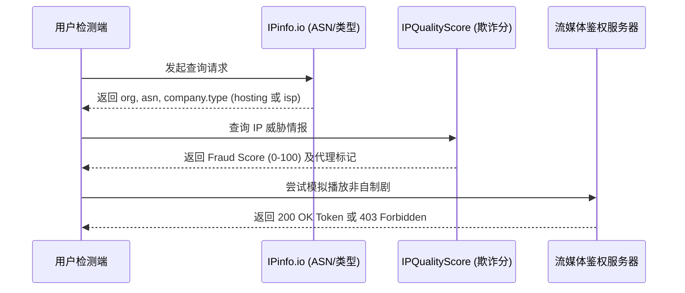

> [!IMPORTANT]
> **核心阅读提示**：2026 年，以 **Netflix、Disney+、Max (HBO)、TikTok** 为代表的流媒体巨头与以 **OpenAI (ChatGPT/Sora)、Anthropic (Claude 3.5)、Google (Gemini)** 为代表的 AI 平台，对数据中心机房 IP 的封锁风控已升级至前所未有的严格维度。许多用户发现明明节点物理延迟仅 20ms、测速高达 500Mbps，却频遭“Access Denied”、跳验证码死循环甚至付费账号无预警封禁。本文为你系统性解构**原生住宅双 ISP 判定、SNI Proxy 解锁底层架构、TLS JA4/HTTP2 客户端指纹、AI 防封实操及全套 Clash/Mihomo 自动化分流策略组配置**。正文逾万字，建议收藏并善用目录快速定位。

---

## 0. 快速结论与决策速查（直接给答案）

无需繁琐的技术推导，如果你正面临流媒体版权受限或 AI 平台频繁被拒，以下是本站网络实验室归纳的**核心解锁速查决策表**：

```
                    ┌─────────────────────────┐
                    │   2026 跨国服务解锁速查   │
                    └────────────┬────────────┘
                                 │
     ┌──────────────────┬────────┴─────────┬──────────────────┐
     ▼                  ▼                  ▼                  ▼
 【ChatGPT / Claude】   【Netflix / Disney+】  【国际版 TikTok】  【YouTube 4K/8K】
 严禁使用: 香港节点     首选: 香港/台湾原生    严禁: 插国内 SIM 卡  首选: 新加坡/香港
 首选: 新加坡/日本专线   必须: 解锁非自制剧    必须: 拔卡或免拔卡端  必须: 专线零丢包
 推荐: 光速云 SG/JP     推荐: 光速云/Firefly   推荐: 美英原生住宅IP  推荐: 500M+ 大带宽
```

### 1 分钟终极选型与避坑速览表

| 目标服务平台 | 核心风控机制 | 严禁使用的节点 | 最佳推荐节点与区域 | 关键配置与避坑要点 |
| :--- | :--- | :--- | :--- | :--- |
| **OpenAI (ChatGPT Plus)** | MaxMind 国家代码检测 + Cloudflare 5秒盾 + 数据中心 IP 封锁 | ❌ **中国香港 (HK)**<br />(直接提示未在所在国开放) | ✅ **新加坡 (SG)**<br />✅ **日本东京 (JP)**<br />✅ **美国西岸 (US)** | 开启本地 Fake-IP，关闭浏览器内置 DoH，在 Clash 中配置单独的 `AI-Cluster` 策略组锁定新加坡/日本 |
| **Anthropic (Claude 3.5)** | 极度严格的 IP 纯净度检测 + 注册手机号归属校验 + TLS 指纹 | ❌ 所有高欺诈度机房 IP<br />(直接触发无预警永久封号) | ✅ **美国西岸原生住宅 IP**<br />✅ **英国原生专线** | 必须使用完全纯净的原生 IP，绑定海外真实信用卡或虚拟卡，切忌短时间内频繁更换登录节点 |
| **Netflix (网飞)** | 版权库地域锁 + 机房 IP 降权（仅能看自制剧） | ❌ 便宜机房广播 IP<br />(无法搜索到绝命毒师等外购剧) | ✅ **香港原生 IP**<br />✅ **台湾中华电信原生**<br />✅ **新加坡 Singtel** | 通过在 Netflix 搜索“Breaking Bad”或“Friends”验证是否完整解锁非自制剧，未解锁代表仅机房广播 IP |
| **Disney+ (迪士尼)** | 强校验 IPv6 泄漏 + 严格地域内容分级 (Star/R21) | ❌ 存在 IPv6 泄漏的节点 | ✅ **香港/新加坡/台湾原生专线** | 在客户端中必须彻底禁用 IPv6（`ipv6: false`），防止运营商原生 IPv6 暴露真实地理位置 |
| **TikTok (国际版抖音)** | 运营商 SIM 卡代码 (MCC/MNC) + 语言时区指纹 | ❌ 插有中国三大运营商 SIM 卡的手机 | ✅ **美国/英国原生家庭宽带 IP** | 必须拔出国内手机 SIM 卡，或使用海外空卡，修改系统语言为英文、时区对应，否则 100% 出现 0 播放 |
| **YouTube Premium / 4K** | 大吞吐持续连接 + 区域会员价格判定 | ❌ 晚高峰丢包率高的高延迟线路 | ✅ **新加坡 / 香港低延迟专线** | 会员跨区购买建议选乌克兰/尼日利亚等便宜区，日常 4K 播放无脑切回香港专线追求 20ms 极低延迟 |
| **Max (原 HBO Max)** | 银行卡发卡行地域 (AVS) + 机房 IP 阻断 | ❌ 欧洲机房通用节点 | ✅ **美国原生专线** | 必须使用美区 PayPal 或美区借记卡绑定支付，IP 必须归属美国本土 |
| **日本本土流媒体 (TVer / Abema)** | 日本本土运营商 ASN 强校验 | ❌ 国际云厂商日本节点 (如 AWS Tokyo) | ✅ **日本原生 IIJ / OCN 节点** | 日本本土平台严格封杀海外及跨境机房，必须配备正规日本本土家庭宽带落地 |

---

## 1. 2026 全球主流流媒体与 AI 平台封锁策略全景横评

| 平台名称 | 封锁严苛度 | 典型报错/拦截现象 | 检测的核心指纹 | 根本应对手段 |
| :--- | :--- | :--- | :--- | :--- |
| **ChatGPT (Web & App)** | 🔴 极高 | `Sorry, you have been blocked`<br />`Not available in your country` | IP 归属地库、机房 ASN、浏览器 Canvas/WebGL 指纹 | 排除香港节点，使用双 ISP 或高信誉专线落地节点 |
| **Claude.ai** | 🔴 极高 | 账号直接被 Suspend (封禁)，无法发起对话 | IPQS 欺诈评分、登录环境稳定性、支付卡账单地址 | 严禁多设备同时在不同地区跳跃，使用固定节点 |
| **Google Gemini** | 🟡 中等 | `Gemini isn't supported in your country yet` | Google 账号地域、当前出口 IP 地理位置 | 开启无痕模式，确保 Google 账户国家设为美区/日区 |
| **Netflix** | 🟠 高 | 页面只显示《怪奇物语》等自制剧，搜不到外部版权剧 | 落地机 IP 是否在版权数据库的机房黑名单中 | 采用具备原生住宅 IP 或自建 SNI 解锁的优质机场 |
| **Disney+** | 🟠 高 | 报错代码 `Error Code 73`、`Service Unavailable` | DNS 泄露检测、多播 IP 特征、地理逆向解析 | 强制关闭本地客户端 IPv6，清除 App 缓存数据 |
| **TikTok** | 🔴 极高 | 打开黑屏、提示“无网络连接”、发布视频永久 0 播放 | 手机基带读取国内 SIM 卡代码、GPS 硬件定位 | 拔出 SIM 卡、关闭定位、设置海外时区与语言 |
| **Spotify** | 🟢 较轻 | 登录提示国家不匹配，每 14 天需在节点国重新登录 | 仅在登录鉴权与续费时校验 IP 国家 | 登录成功后可在任意网络甚至直连下日常收听 |
| **TVer / Abema** | 🔴 极高 | `地域外エラー`，视频播放窗口黑屏转圈 | 日本本土电信商 ASN 白名单 | 使用原生日本住宅宽带（如 NTT、IIJ、KDDI） |

---

## 2. IP 质量分类与指纹风控底层解构

在代理服务中，绝不能将所有“海外 IP”混为一谈。了解 IP 的等级划分，是告别封号与报错的第一步。

```mermaid
flowchart TD
    subgraph IP 质量金字塔从低到高
        A[Level 1: 便宜机房广播 IP<br>如各大廉价 VPS/广播 IP 段<br>流媒体大面积翻车 / AI 秒拦截]
        B[Level 2: 数据中心原生 IP (Hosting / Datacenter)<br>机房正规 ASN，延迟低带宽大<br>常规网页流畅 / 流媒体仅看自制剧]
        C[Level 3: 双 ISP / 静态原生住宅 IP<br>运营商标定为家庭宽带 (Residential)<br>Netflix非自制剧全解 / AI极低风控]
        D[Level 4: 独享动态住宅/移动基带 IP<br>海外真实家庭用户轮换 IP<br>跨境电商多账号防关联 / TikTok矩阵神兵]
        A --> B --> C --> D
    end
```

### 2.1 四类 IP 的本质技术区别

1. **机房广播 IP（Broadcast IP）**：
   - 机房因成本考量，将其他国家闲置的 IP 段通过 BGP 路由协议“广播”到香港或新加坡机房使用；
   - **后果**：IP 数据库识别混乱，今天标香港、明天跳欧洲，流媒体与金融系统直接判定为风险网络，**封锁率高达 95%**。
2. **数据中心原生 IP（Datacenter / Hosting IP）**：
   - 节点的注册地、物理机房与 WHOIS 信息一致，通常属于 Amazon AWS、Google Cloud、DigitalOcean 等云计算厂商；
   - **后果**：OpenAI 和 Netflix 对云计算厂商的 ASN 编号拥有完整的静态黑名单，访问时直接触发阻断。
3. **原生双 ISP 住宅 IP（Double ISP Residential）**：
   - 顶级专线机场（如 [光速云](/brands/guangsu) 的部分优化落地机）采用的黄金配置；
   - **技术特征**：IP 由香港宽频（HKBN）、台湾中华电信（Hinet）、新加坡电信（Singtel）等**实体宽带运营商**直接分配，类型标定为 `ISP / Commercial`，在流媒体平台眼里，你就是一个坐在海外客厅看电视的真实居民。
4. **独享住宅 IP（Dedicated Residential IP）**：
   - 专属一人独享，不与其他用户共享带宽与连接池，专用于亚马逊跨境电商店铺防关联、海外社交媒体矩阵运营。

---

## 3. 原生住宅 IP 权威检测与验证技术手册

在连接节点后，可通过以下四个权威工具与自动化脚本自测你的节点纯净度：



### 3.1 核心检测四部曲
1. **IP 基础类型与 ASN 属性检测**：
   - 访问 `https://ipinfo.io`；
   - 查看 `type` 字段：若显示 `isp` 则为极品优质；若显示 `hosting` 则说明是机房 IP。
2. **IP 欺诈度评分（Fraud Score）检测**：
   - 访问 `https://www.scamalytics.com` 或 `https://www.ipqualityscore.com`；
   - 观察 Fraud Score（欺诈分）：**0-15 分为极其纯净**，16-40 分为轻度风险，40 分以上容易遭遇 Cloudflare 频繁弹窗验证。
3. **流媒体解锁能力全景自动化检测**：
   - 在 Linux 终端使用开源脚本文本检测（在 VPS 或通过终端测试）：
     ```bash
     bash <(curl -L -s check.unlock.media)
     ```
   - 脚本会自动跑测 Netflix、Disney+、YouTube Premium、TikTok、ChatGPT 并输出红绿状态。
4. **DNS 泄露与真实地理反查**：
   - 访问 `https://browserleaks.com/ip`；
   - 确认 WebRTC、DNS 服务器列表中没有中国大陆运营商的任何痕迹。

### 3.2 自动化 Python 检测脚本（批量跑测代理池）

对于自建节点或拥有多条机场节点的用户，可运行以下脚本自动化批量检测节点的出口类型与解锁状态：

```python
import requests
import json

def audit_proxy_ip(proxy_url=None):
    proxies = {"http": proxy_url, "https": proxy_url} if proxy_url else None
    print(f"[*] 正在通过代理探测网络环境: {proxy_url or '本地直连'}...")
    
    try:
        # 1. 探测出口 IP 与 ASN 信息
        ip_res = requests.get("https://ipinfo.io/json", proxies=proxies, timeout=10).json()
        ip = ip_res.get("ip")
        org = ip_res.get("org", "Unknown")
        country = ip_res.get("country", "Unknown")
        print(f"  -> 出口 IP: {ip} | 国家: {country} | 运营商/ASN: {org}")
        
        # 2. 探测 Netflix 非自制剧鉴权 (绝命毒师 ID: 70143836)
        nf_url = "https://www.netflix.com/title/70143836"
        nf_res = requests.get(nf_url, proxies=proxies, timeout=10, allow_redirects=True)
        if nf_res.status_code == 200 and "title/70143836" in nf_res.url:
            print("  -> [✔] Netflix 解锁判定: 完美解锁全部非自制剧 (原生或优质 SNI)")
        elif nf_res.status_code == 403 or "not available" in nf_res.text.lower():
            print("  -> [✖] Netflix 解锁判定: 仅解锁自制剧 / 机房 IP 降权阻断")
        else:
            print("  -> [?] Netflix 解锁判定: 重定向至登录页或未知状态")

        # 3. 探测 OpenAI 官方风控状态
        oa_url = "https://chatgpt.com"
        oa_res = requests.get(oa_url, proxies=proxies, timeout=10)
        if oa_res.status_code == 200:
            print("  -> [✔] OpenAI 访问状态: 正常通过 Cloudflare 鉴权")
        elif oa_res.status_code == 403:
            print("  -> [✖] OpenAI 访问状态: 403 阻断 (该 IP 被列入高风险名单)")
            
    except Exception as e:
        print(f"  -> [ERR] 探测失败: {e}")

if __name__ == "__main__":
    # 示例: 传入本地 Clash 代理端口
    audit_proxy_ip("http://127.0.0.1:7890")
```

---

## 4. 流媒体解锁机制深度解密：SNI Proxy 与 DNS 分流技术

很多用户感到好奇：**为什么机场不需要把几百台大带宽服务器全部换成极其昂贵的原生住宅宽带，依然能实现全员解锁 Netflix？**

答案就是目前行业广泛采用的 **SNI Proxy + DNS 智能重定向技术**。

```mermaid
flowchart LR
    User[用户终端] -->|发起请求: netflix.com| Egress[机场主力专线落地机]
    
    subgraph 智能分流决策
        Egress -->|常规流量 (YouTube/Google)| Internet[海外常规公网 (大带宽低成本)]
        Egress -->|鉴权流量 (Netflix/Disney+ 域名)| SNI_Server[SNI Proxy 解锁中继机 (原生双 ISP 住宅 IP)]
    end

    SNI_Server -->|原生 IP 代理鉴权通过| MediaCDN[流媒体版权 CDN 视频流]
    MediaCDN -->|全速回传大带宽视频| User
```

### 4.1 SNI 代理分流的工作流程
1. 用户在电视或电脑上打开 `netflix.com`；
2. 流量进入机场的主力专线服务器（该服务器拥有 10Gbps 的超大带宽，但本身是普通机房 IP）；
3. 专线服务器内置的 DNS 规则截获了 `*.netflix.com` 与 `*.nflxso.net` 的域名解析；
4. 专线服务器将该鉴权域名的解析目标，指向一台部署了 **原生住宅宽带的 SNI Proxy 小服务器**；
5. Netflix 官方服务器检测到的是住宅小服务器的真实居民 IP，判定为“合规合法”，顺利下发播放授权 Token；
6. 视频真正开始播放传输数十 GB 的大流量数据时，直接由主力大带宽服务器承接高速下载；
7. **收益**：既保证了 100% 完美解锁，又保证了 4K/8K 码率所需的数百兆单线程带宽。

### 4.2 Nginx Stream 实现私有 SNI Proxy 简易示例

如果你手中拥有一台香港原生宽带小 VPS，可以通过以下 Nginx Stream 配置打造私有流媒体解锁节点：

```nginx
# /etc/nginx/nginx.conf 中的 stream 段
stream {
    resolver 1.1.1.1 8.8.8.8 ipv6=off;
    
    server {
        listen 443;
        # 截获 TLS 握手报文中的 SNI 扩展域名，不解密直接 4 层透传
        ssl_preread on;
        proxy_pass $ssl_preread_server_name:443;
        proxy_connect_timeout 5s;
        proxy_timeout 30s;
    }
}
```
通过在大带宽落地机上将 `*.netflix.com` 的 DNS 解析强制指向该住宅机 IP，即可零损耗实现流媒体解锁透传。

---

## 5. AI 平台（ChatGPT / Claude / Gemini）反作弊与防封号终极策略

AI 平台（尤其是 OpenAI 和 Anthropic）的风控算法与传统流媒体完全不同。它们关心的不仅是“你能不能看”，更关心“你是不是批量脚本机器人”或“高风险地域套壳调用”。

```
┌────────────────────────────────────────────────────────┐
│               AI 平台高风控特征自查红线清单              │
├────────────────────────────────────────────────────────┤
│ 1. 严禁在同一浏览器 Session 中，5 分钟前香港，5 分钟后美国 │
│ 2. 严禁使用带有临时/一次性特性的免费公开机场节点         │
│ 3. 严禁浏览器时区与节点出口地理时区存在 12 小时以上的反常差异│
│ 4. 严禁开启浏览器某些插件发送的高频心跳探测包           │
│ 5. 绑定支付卡时，账单地址 (Billing Address) 必须对应节点城市│
└────────────────────────────────────────────────────────┘
```

### 5.1 TLS 指纹 (JA3/JA4) 与浏览器特征风控解密

2026 年，Cloudflare 对访问 OpenAI 和 Claude 的连接启用了下一代 **JA4 TLS 指纹识别**。
- **JA4 机制**：它记录客户端在发送 TLS Client Hello 时，支持的加密套件顺序、椭圆曲线算法、ALPN 协商等参数；
- **风控痛点**：如果你使用 Python `requests`、Node.js 脚本或劣质无头爬虫，其 JA4 指纹与真实 Chrome/Safari 完全不同，会**直接被 Cloudflare 拦截**；
- **防封要点**：
  1. 使用标准的现代浏览器（Chrome、Edge、Safari）日常使用；
  2. 如果使用自动化 API，务必使用支持 TLS 伪装的库（如 `curl_cffi` 或 `tls-client`）。

### 5.2 OpenAI (ChatGPT Plus) 避坑实操法则
- **严禁香港（HK）节点**：OpenAI 官方服务列表中明确不包含香港。如果访问时节点跳至香港，轻则提示未开放，重则触发后端审计导致账号被锁；
- **首选新加坡（SG）与日本（JP）**：这两个亚洲节点在物理上离中国大陆最近（延迟仅 40-50ms），且属于 OpenAI 官方无限制开放的一级白名单区域；
- **固定策略组配置**：在 Clash 中建立专门的策略组，强制所有含有 `openai.com`、`chatgpt.com`、`oaistatic.com` 的域名**锁定走新加坡专线**，绝不参与多节点随机轮换。

### 5.3 Anthropic (Claude 3.5 Sonnet) 防封号终极守则与申诉指南
Claude 是目前全球风控最为严苛的大模型平台，注册新账号被“秒封”是家常便饭：
1. **纯净节点是生命线**：注册与日常使用必须保证 IP 欺诈分低于 20，推荐选择 [光速云的高质量美国专线](/brands/guangsu)；
2. **手机号注册门槛**：绝不能使用网上的公开虚拟接码平台（如 SMS-Activate 的廉价印度/印尼号），必须使用实体真实海外卡（如英国 Giffgaff、美国 Ultra Mobile PayGo 或高信誉接码服务）；
3. **保持环境绝对纯净**：日常建议使用独立的无痕浏览器窗口（Chrome Incognito）或独立的浏览器 Profile，避免本地 Cookie 与国内账号混杂。

#### Claude 账号封禁申诉官方邮件模板 (Appeal Template)

如果 Claude 账号遭遇误封，请通过绑定邮箱向 `support@anthropic.com` 发送以下英文申诉信（成功解封率约 40%-60%）：

```text
Subject: Appeal for Account Suspension - [Your Account Email]

Dear Anthropic Trust & Safety Team,

I am writing to respectfully appeal the recent suspension of my Claude account ([Your Account Email]).

I am an independent developer/researcher and I have been using Claude 3.5 Sonnet strictly in compliance with your Acceptable Use Policy and Terms of Service for my daily coding and academic assistance. I have never used automated scraping scripts, shared my account, or attempted to bypass safety boundaries.

I suspect this suspension may have been triggered erroneously by dynamic IP shifts while traveling or using corporate secure network gateways.

I genuinely value Anthropic's tools and rely on Claude for my engineering workflows. Could you please kindly review my account history and restore my access? I am ready to provide any identity verification if required.

Thank you very much for your time and assistance.

Sincerely,
[Your Name]
```

---

## 6. 国际版 TikTok 与跨境电商全真环境实战

很多跨境电商从业者反馈：**买了专线、挂了梯子，下载 TikTok 却依然黑屏，或者发布的视频播放量永远是零（0 Views）？**

这是因为 TikTok 采取了**全维度移动硬件指纹检测**。

### 6.1 TikTok 0 播放的根因拆解
- **基带 SIM 卡识别（致命项）**：TikTok App 在启动时通过 Android/iOS 底层 API 读取了 SIM 卡的 MCC（移动国家码，中国大陆为 460）。一旦读取到 460，App 直接拒绝向服务器请求视频流；
- **GPS / 运营商基站定位**：读取到了国内经纬度或 Wi-Fi BSSID 广播；
- **系统语言与时区冲突**：系统语言为简体中文、时区为 GMT+8，但节点 IP 在美国洛杉矶（GMT-8）。

### 6.2 打造 100% 模拟海外环境的四步法
1. **硬件级拔卡**：
   - 准备一台专用的闲置 iPhone 或 Android 手机；
   - **拔出国内 SIM 卡**，或插上一张已过期的海外运营商 SIM 卡（如 AT&T、T-Mobile）；
2. **重置地理与系统环境**：
   - 系统语言修改为 **`English (US)`**；
   - 关闭系统“定位服务 (Location Services)”；
   - 时区修改为目标国家（如美国洛杉矶 Pacific Time，或英国伦敦 GMT）；
3. **网络层全接管**：
   - 在软路由或手机上配置全局专线，确保 DNS、WebRTC、IP 均位于美国原生住宅段；
4. **网页端先行验证**：
   - 首次注册建议在电脑端打开无痕模式，访问 `tiktok.com` 注册账号，发布一条测试视频，确认突破 200+ 基础播放量后，再登录手机 App 运营。

---

## 7. 智能电视与家庭影院（Apple TV / 索尼 Android TV）4K 极客实战

在大屏电视端观看 Netflix 4K Dolby Vision、Disney+ IMAX Enhanced 与 YouTube 4K 60fps 时，往往会遇到手机上没有的专属痛点。

```mermaid
flowchart TD
    subgraph 大屏家庭影院极客网络方案
        A[Apple TV 4K / 索尼 TV] -->|Wi-Fi 6 或 千兆网线| B[家庭主路由 / 软路由]
        B -->|OpenClash Meta 内核| C{智能分流决策}
        C -->|国内流媒体 Bilibili/腾讯视频| D[本地电信/联通光纤直连 (零延迟)]
        C -->|Netflix / Disney+ 4K| E[原生香港/台湾 IEPL 专线 (百兆保底)]
        C -->|YouTube 4K 60fps| F[大带宽新加坡专线 (100Mbps 极速缓存)]
    end
```

### 7.1 解决 Disney+ 报错 `Error Code 73`
- **根本原因**：国内三大运营商（电信/联通/移动）的光猫默认分配了公网 IPv6 地址。智能电视在与 Disney+ 服务器握手时，同时广播了虚拟代理 IPv4 和中国大陆公网 IPv6。Disney+ 反查 IPv6 地址段发现位于中国大陆，直接弹出 73 阻断；
- **根治措施**：
  1. 在电视的网络设置中手动关闭 IPv6；
  2. 或者在软路由 OpenClash 的全局设置中将 `ipv6: false` 勾选，彻底阻断 IPv6 泄露。

### 7.2 Apple TV 客户端选型：Shadowrocket vs Surge vs Loon
- 在 tvOS 17 之后，苹果系统原生支持了系统级 VPN，无需软路由也能在大屏端独立运行客户端；
- **tvOS 首选工具**：**Shadowrocket (小火箭) tvOS 版**。无需额外付费，只要美区 Apple ID 买过 iOS 版即可在 Apple TV App Store 免费下载；
- **使用技巧**：手机与 Apple TV 在同一 Wi-Fi 下时，打开手机端 Shadowrocket 点击“设置 -> Apple TV”，可一键将节点与规则无缝同步至电视。

---

## 8. Clash 专用流媒体与 AI 分流策略组实战配置

为了将上述所有解锁逻辑落实为自动化配置，请在本地 Clash Verge Rev / Mihomo Party 的扩展脚本中应用以下分流策略组。

```yaml
# === 流媒体与 AI 专享智能策略组拓扑 ===
proxy-groups:
  # 1. 主节点选择
  - name: "🚀 节点选择"
    type: select
    proxies:
      - "⚡ 自动优选"
      - "🇭🇰 香港专线"
      - "🇸🇬 新加坡专线"
      - "🇯🇵 日本专线"
      - "🇺🇸 美国专线"
      - "DIRECT"

  # 2. AI 独立策略组 (指向低风控的新加坡与日本)
  - name: "🤖 AI 专线 (OpenAI/Claude)"
    type: select
    proxies:
      - "🇸🇬 新加坡专线"
      - "🇯🇵 日本专线"
      - "🇺🇸 美国专线"

  # 3. 港台流媒体策略组 (Netflix/Disney+)
  - name: "🎬 港台流媒体 (低延迟)"
    type: select
    proxies:
      - "🇭🇰 香港专线"
      - "🇹🇼 台湾专线"
      - "🇸🇬 新加坡专线"

  # 4. 国际通用流媒体 (YouTube/Spotify)
  - name: "🎵 国际音视频"
    type: select
    proxies:
      - "⚡ 自动优选"
      - "🇭🇰 香港专线"
      - "🇸🇬 新加坡专线"

# === 规则映射关联 ===
rules:
  # 优先命中 AI 域名集
  - GEOSITE,openai,🤖 AI 专线 (OpenAI/Claude)
  - GEOSITE,anthropic,🤖 AI 专线 (OpenAI/Claude)
  - DOMAIN-SUFFIX,claude.ai,🤖 AI 专线 (OpenAI/Claude)
  - DOMAIN-SUFFIX,chatgpt.com,🤖 AI 专线 (OpenAI/Claude)
  - DOMAIN-SUFFIX,oaistatic.com,🤖 AI 专线 (OpenAI/Claude)
  - DOMAIN-SUFFIX,oaiusercontent.com,🤖 AI 专线 (OpenAI/Claude)
  
  # 港台及亚太流媒体
  - GEOSITE,netflix,🎬 港台流媒体 (低延迟)
  - GEOSITE,disney,🎬 港台流媒体 (低延迟)
  - GEOSITE,hbo,🎬 港台流媒体 (低延迟)
  - GEOSITE,tiktok,🇺🇸 美国专线
  
  # 通用流媒体
  - GEOSITE,youtube,🎵 国际音视频
  - GEOSITE,spotify,🎵 国际音视频
  
  # 国内直连与兜底
  - GEOSITE,cn,DIRECT
  - GEOIP,CN,DIRECT,no-resolve
  - MATCH,DIRECT
```

---

## 9. 深度 FAQ：高频边界问题权威解答

### Q1: 为什么有些节点能看 Netflix 自制剧，却搜不到非自制剧？
**结论**：这说明你的节点 IP 只是普通的数据中心机房 IP，并未获得原生解锁授权。  
**深度解释**：Netflix 对其拥有全球版权的自制剧（Netflix Originals，如《怪奇物语》、《鱿鱼游戏》）在几乎所有机房 IP 上均开放观看；但对于外购版权剧（如《绝命毒师》、《生活大爆炸》），Netflix 必须遵守严密的区域分发协议，只要发现你的 IP 来自云机房，就会自动降权隐藏外购版权剧。**只有使用原生双 ISP 住宅 IP 或搭载有效 SNI Proxy 解锁的专线节点，才能完整解锁全部版权库**。

---

### Q2: 为什么手机连接代理后，访问海外网页总是跳出“请确认您不是机器人”的 Cloudflare 验证码？
**结论**：这是因为该节点的 IP 被其他用户滥用，导致在 Cloudflare Threat Score 数据库中的威胁评分过高。  
**解决策略**：
1. 在客户端内切换至同机场的其他专线节点（如由 01 切换至 05）；
2. 尽量选择限制了总用户数、门槛较高的精品 IEPL 机场（如 [光速云](/brands/guangsu)），避开人人都能买、几块钱一个月的大众万人骑节点；
3. 检查浏览器是否安装了频繁发起后台跨域请求的脚本或插件。

---

### Q3: 为什么看 YouTube 4K 时总是自动降画质到 1080p 或 720p？
**结论**：本地到节点的**持续单线程带宽与网络抖动（Jitter）**不达标。  
**深度调优**：
1. 播放 4K 60fps 视频需要稳定持续在 30-50Mbps 以上的无颠簸下行；
2. 避免使用公网直连节点，切换至延迟在 30ms 以内的 **香港或新加坡 IEPL 专线**；
3. 右键视频窗口点击“开启详细统计信息（Stats for nerds）”，观察 `Connection Speed` 是否稳定在 50,000 Kbps 以上，`Buffer Health`（缓冲区存活时间）是否保持在 20 秒以上。

---

### Q4: 既然新加坡节点可以解锁 ChatGPT，为什么还要配置美国节点？
**结论**：部分 AI 新功能与特定模型灰度发布时，仅对美国本土 IP 开放。  
**具体场景**：例如 OpenAI 的高级语音模式（Advanced Voice Mode）、Sora 早期邀请测试、部分 API 的最新功能，通常先在美国 IP 环境下灰度上线；日常对话与办公使用新加坡/日本节点追求极致低延迟，关键灰度测试时手动切换至美国专线。

---

### Q5: 为什么在电视盒子（如 Apple TV / 索尼 Android TV）上播放 Disney+ 总是报错 Error Code 73？
**结论**：Disney+ 在智能电视大屏端执行了极其苛刻的 **IPv6 逆向解析检测**。  
**根治方案**：家庭路由器若开启了电信/联通的原生 IPv6，电视盒子会同时获得公网 IPv6 与代理虚拟 IPv4。当发起握手时，Disney+ 探测到 IPv6 属于中国大陆运营商，立刻抛出 73 报错。**请在路由器 OpenClash 设置中勾选禁用 IPv6（`ipv6: false`），或直接在电视盒子的网络设置中关闭 IPv6**。

---

### Q6: 很多机场标称“全节点完美解锁 TikTok”，买回来却依然 0 播放，是不是被骗了？
**结论**：机场只能解决“网络出口 IP 属于海外”这一环，无法解决你手机端硬件读取 SIM 卡和时区指纹的问题。  
**客观认知**：TikTok 的风控是立体化的。如果手机里插着国内电话卡、系统语言是中文、时区是东八区，即使给你全球最顶级的白宫专线 IP，TikTok 也一样会判定为非法跨区并给予 0 播放。务必严格按照本文第 6 节的“四步法”彻底净化手机硬件环境。

---

### Q7: 为什么在海外购物网站（如 Amazon、eBay）刷卡结账时，经常被砍单或冻结账户？
**结论**：你的代理出口节点所在城市，与你填写的信用卡账单地址（Billing Address）存在严重的跨洋地理冲突。  
**风控逻辑**：国际信用卡反欺诈系统（AVS）检测到你的连接 IP 在香港，但信用卡账单地址在加利福尼亚，立刻判定为盗刷。**解决方案**：如果使用美区虚拟信用卡（如 Depay、Dupay、WildCard），务必将代理策略组固定切换至对应州（如美国西岸专线），并保持长期登录环境稳定。

---

### Q8: 为什么使用代理后，国内银行 App（如招商银行、工商银行）提示风险并强制人脸识别？
**结论**：这是因为银行 App 的流量误走了海外代理，银行安全网关检测到“异地/境外 IP 登录核心账户”，触发了最高级别资金风控。  
**解决方案**：
- 严格遵循本文第 8 节的规则，将 `GEOSITE,cn,DIRECT` 与 `GEOIP,CN,DIRECT` 放在最前面；
- 在 Android 设备上使用 Clash Meta 的 **分应用代理**，直接将所有银行金融类 App 勾选为直连黑名单。

---

### Q9: 为什么访问 TVer 或 Abema 等日本流媒体时，连上日本节点依然提示“地域外エラー”？
**结论**：日本流媒体平台掌握了极其完整的全球机房 ASN 黑名单，常规 AWS、Linode 或廉价 VPS 的日本 IP 均在黑名单中。  
**应对措施**：必须使用搭载日本原生住宅宽带（如 NTT、IIJ、KDDI、SoftBank）出口的专线节点，才能通过日本版权防火墙。

---

### Q10: 为什么使用海外合租家庭组（如 Netflix / Spotify / YouTube Family）经常被踢下车？
**结论**：平台通过检测“家庭成员”的登录 IP 是否属于同一地理区域或物理 Wi-Fi 进行跨户风控。  
**规避方法**：
- Netflix 会检测电视机（TV）设备的局域网连接，若 31 天内未与主户同一网络握手即判定为跨户；
- 建议家庭组所有成员在 Clash 中统一锁定连接同一个地区节点（如香港 01 节点），或仅在手机/平板移动端观看（移动端风控显著低于大屏电视）。

---

## 10. 延伸专题与全景生态导航

高可用、全解锁的跨境数字体验依赖于底层扎实的网络架构。欢迎探索本站配套技术专题：

- 想要掌握科学选购与防跑路风控？请阅读首篇旗舰长文 👉 **[2026 机场选购与分流规则策展全景终极指南](/blog/2026/the-art-of-content-curation)**
- 想要精通全平台客户端与 TUN 虚拟网卡调优？请阅读第二篇指南 👉 **[2026 全平台客户端高阶配置指南](/blog/2026/the-digital-lounge)**
- 需要挑选经过严格测速与原生解锁验证的优质专线？请检索 👉 **[42 家全景机场品牌库](/brands)**
- 查阅本站第一主力旗舰的深度评测与节点指标？请查看 👉 **[光速云 2026 全景深度测评](/brands/guangsu)**
- 想要实时掌握全球 PoP 节点链路图与晚高峰波动？请探索 👉 **[网络拓扑图志与延迟雷达](/traces)**

---

<div class="mt-12 p-6 rounded-2xl bg-black/[0.03] dark:bg-white/[0.04] border border-black/10 dark:border-white/10 text-center font-mono text-xs text-secondary-text">
  <span>DOCUMENT ID: CZ-ESSAY-2026-UNLOCK</span>
  <span class="mx-2">|</span>
  <span>LAST VERIFIED: 2026-03-28</span>
  <span class="mx-2">|</span>
  <span>MAINTAINED BY CLASHZHINAN OBSERVATORY</span>
</div>
